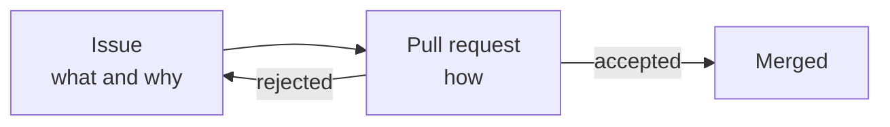

# Agent Interaction

Human and agent participants need durable coordination when they work in the same repository.
A conversation outside the platform artifacts does not provide the repository's reviewed
work record. It can become unavailable when the session ends.

The framework uses the platform's issues, labels, and pull requests as that record.

## Coordination happens on artifacts

All coordination between humans and agents MUST happen through platform artifacts — issues,
labels, and pull requests — rather than through any channel that leaves no trace in the
repository.

The rule follows from
[everything as code](../../Ways-of-Working/Principles/Engineering-Practices.md#everything-as-code).
Repository artifacts preserve decisions and their reasons. Unlike session context, an issue
remains available to another agent, runtime, or person after the original session ends.

| Artifact | What it carries | Why it, specifically |
| --- | --- | --- |
| **Issue** | The intent: what is wanted, why, and what "done" means | Durable, addressable, and independent of who acts on it |
| **Label** | A discrete decision or state transition | Machine-readable, so automation can react without parsing prose |
| **Pull request** | The proposed implementation and its review | Reviewable line by line, and revertible as one unit |
| **Comment** | Reasoning, questions, and advice attached to its subject | Keeps reasoning with the relevant artifact |

## Two artifacts, two questions

Intent MUST be recorded separately from implementation. The issue states *what* is wanted and
*why*; the pull request proposes *how*.

The canonical [issue planning altitude](../../Ways-of-Working/Issues/Process/Planning.md)
governs the issue body. Task and Bug leaves retain technical decisions and test-first plans;
the pull request contains the proposed implementation. Consumer-only aggregate guidance does
not remove those delivery plans.

The issue preserves the request when reviewers reject a proposed implementation.
The pull request can close while the issue remains open. The rejected pull request records
the attempted approach. A later proposal can use that evidence without reconstructing the
original intent.

This separation also supports different review questions. Priority and fit determine whether
work is needed. Implementation review determines whether the proposed change is correct.
The reviewers for these questions can differ.

An issue exists before work starts to resolve it. For a genuinely trivial change, the pull
request MAY stand alone, but it contains its own statement of intent.

## Labels are the control channel

Where automation must be told something, it MUST be told with a label rather than with prose.

Prose records reasoning and nuance. A label records an explicit machine-readable signal,
including who applied it and when. Rules can require or prohibit that signal without
inferring approval from a sentence.

Labels used for coordination MUST follow the organization's
[label vocabulary](../../Ways-of-Working/Automation-Labels.md). Its owner and meaning can
then be determined without reading the workflow that consumes it. Automation MUST ignore
labels it does not own.

## An agent is a participant, not an authority

An agent operating on these artifacts MUST do so under the same rules as any other
participant.

Agents open issues and pull requests instead of pushing to protected branches. Their changes
receive review, and their conclusions remain advice until someone acts on them. The
[four-eyes principle](../../Ways-of-Working/Principles/AI-First-Development.md#4-eyes-or-n-eyes-principle)
applies to automated participants too. A review by an agent is [advisory](advisory-agents.md),
and humans retain merge authority.

The same rules keep agent work subject to the same review controls as human work.

## Handover is a state, not a message

Participants MUST hand over work through the artifact's state: labels, assignment, or review
status. Handover MUST NOT depend on delivery of a message.

A comment that names the next step requires a reader to act on it. A state change supplies
the signal that the next stage uses. The comment is a notification; the state change is the
handover.

Artifact state preserves the handover across session interruptions. A participant can
determine the next step from that state without reconstructing a conversation.

## Where this connects

- [Spec](spec.md#requirements) — the requirement that coordination happens on durable artifacts and that intent is separable from implementation.
- [Advisory Agents](advisory-agents.md) — how an agent publishes judgment onto these artifacts without taking authority.
- [Automation Labels](../../Ways-of-Working/Automation-Labels.md) — the label vocabulary and ownership rules.
- [Workflow](../../Ways-of-Working/Workflow.md) — the stages these artifacts move through.
- [Issues](../../Ways-of-Working/Issues/index.md) and [Issue Planning](../../Ways-of-Working/Issues/Process/Planning.md) — issue discovery and type-specific intent and delivery planning.
- [PR Format](../../Ways-of-Working/PR-Format.md) — what a pull request states.
