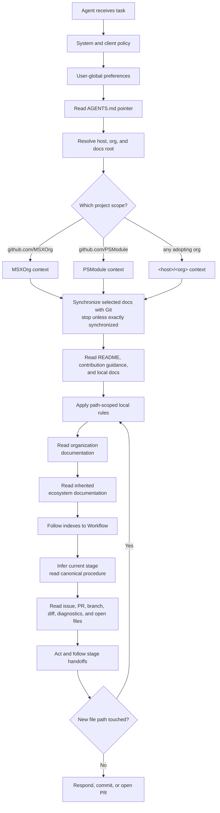

# Agentic Development — Design

The [spec](spec.md) defines the framework's behavior. An organization-level documentation repository owns reviewed project knowledge. Each product repository adopts that guidance through thin pointer files. Each runtime uses the same process knowledge without copying it. The organization selects its documentation repository; the repository name is not fixed.

## Organization anatomy

The GitHub organization is the project boundary. The host distinguishes work from personal projects; the organization selects the project context.

```text
<host>/<org>/
  docs/      # canonical knowledge base; changes through pull requests
  <repo-a>/  # product or component repository
  <repo-b>/
```

The project scopes use these documentation sources:

| Host | Organization | Canonical documentation repository |
| --- | --- | --- |
| `github.com` | `MSXOrg` | `MSXOrg/docs` |
| `github.com` | `PSModule` | `PSModule/Process-PSModule` |
| `<host>` | `<org>` | Designated `<org>/<documentation-repository>` |

An adopting organization uses the same model on a public or enterprise GitHub host. It selects the canonical documentation repository without changing the framework.

## Repository roles

### `docs`

The `docs` repository is the canonical knowledge base. It owns:

- vision, principles, and ways of working;
- coding standards and documentation standards;
- framework and capability specs and designs;
- project glossary and onboarding;
- the canonical Workflow and its linked stage procedures.

Changes to `docs` happen through pull requests because this repository defines durable project intent.

### Product repositories

Product repositories carry local context and thin pointers:

```text
<repo>/
  AGENTS.md                        # required: the router — a list of destinations
  .claude/
    CLAUDE.md                      # required: routes Claude Code — @../AGENTS.md
  .github/
    CONTRIBUTING.md                # conditional: repo-specific instructions or exception
    copilot-instructions.md        # required: routes the Copilot surfaces that need it
    instructions/
      <scope>.instructions.md      # exceptional: a path-scoped local caveat
  README.md                        # what it is, how it builds
  docs/                            # architecture and domain context
```

`README.md` describes the repository and its build. `.github/CONTRIBUTING.md` defines contribution mechanics [when a local guide is needed](../../Ways-of-Working/Repository-Standard.md#contribution-guidance). `docs/` describes architecture and domain context. Path-scoped rule files hold local caveats.

`AGENTS.md` points to those sources; it does not contain their content. Cross-cutting standards remain in the canonical organization documentation. A thin router does not duplicate reusable process. Each repository-specific contract remains in the file that owns it.

Inherited community files are not included in clones. When no local contribution guide is needed, the router links to the initiative's required contribution source in its public `.github` repository. If the source guide is blank, also link to the shared [Contribution Workflow](../../Ways-of-Working/Contribution-Workflow.md). Report a missing required source file in the initiative's community repository; do not create a local guide merely to fill a router entry.

## OKF page model

The `docs` repository uses the [Open Knowledge Format](../../Dictionary/index.md#open-knowledge-format) style: Markdown with YAML frontmatter, one concept per page, paths as stable identity, and indexes for navigation.

Minimum page frontmatter:

```yaml
---
title: Agentic Development
description: One-line description of the page.
---
```

The body stays concise. If a page grows into multiple concepts, split it and link through the nearest `index.md`.

## Indexes as the mindmap

Indexes provide documentation navigation. The agent starts at the root index and reads the page descriptions. The agent follows index links until it reaches the relevant page.

```text
docs/
  index.md
  Ways-of-Working/index.md
  Ways-of-Working/Workflow.md
  Ways-of-Working/Workflow-Stages/index.md
  Coding-Standards/index.md
  Capabilities/index.md
  Capabilities/agentic-development/index.md

```

Every index describes the pages and sections below it. Generated indexes are preferred where tooling exists.

## Context resolution flow



The active repository remote selects project context. For `github.com/PSModule/Json`, the context is `PSModule`. For `github.com/MSXOrg/docs`, the context is `MSXOrg`. In a multi-root workspace, the active file, explicit user prompt, terminal directory, or branch repository selects the project. If that context is ambiguous, ask the user before acting.

## Pointer files

`AGENTS.md` is the cross-runtime router. It lists where to read, in order, and
includes one instruction to prepare linked repositories before reading them. It
holds no detailed synchronization mechanics, build commands, contribution
mechanics, or standards.

```markdown
# AGENTS

Read in this order:

1. `README.md` — what this repository is and how it builds.
2. `.github/CONTRIBUTING.md` — repository-specific contribution instructions, when present.
3. `docs/index.md` — this repository's own documentation.
4. [MSXOrg/docs](https://github.com/MSXOrg/docs/) — the organization standards.

Clone each linked repository locally, keep its configuration local to that
clone, and update it before reading it.

Read nearest first. A local file never overrides a standard.
```

A router lists only destinations that exist. The example does not require that layout. When no local guide is needed, replace that entry with a link to the inherited organization default. If the repository has no documentation, omit that entry. A standards repository omits the duplicate entry when its local and organization documentation use the same tree. The router uses each path or source link literally.

The index trail is the default route. A clear prompt can select a stage directly. `Review this PR <link>` enters Review. `Make this issue <description>` enters Define. `Implement <issue>` enters Implement.

[Workflow](../../Ways-of-Working/Workflow.md#find-the-current-stage) interprets these phrases as routing hints. They do not define independent procedures.

> **Reading order vs. conflict precedence** — the router reads repository files before organization documentation. This order provides specific context before broader context. Conflict precedence runs in the opposite direction: repository files add detail and narrow exceptions. They do not override an organization standard unless that standard permits a local exception.

`.claude/CLAUDE.md` is a single import:

```markdown
@../AGENTS.md
```

Claude Code accepts either `./CLAUDE.md` or `./.claude/CLAUDE.md` as the project file. It resolves each relative import from the file that contains it. From `.claude/`, the router is `../AGENTS.md`. An import of `@AGENTS.md` instead resolves to `.claude/AGENTS.md`, so it does not load the repository router.

`.github/copilot-instructions.md` has the same shape, for the Copilot surfaces that do not read `AGENTS.md`:

```markdown
Follow the instructions in [AGENTS.md](../AGENTS.md).
```

The file contains only that pointer. It does not duplicate reading order, workflow, or standards. Other runtimes use a route under their recognized filename and keep shared content in `AGENTS.md`.

Path-scoped instruction files are reserved for local rules that cannot live centrally because they apply only to a repository path, and only when the rule does not belong in `README.md` or `.github/CONTRIBUTING.md` instead. They never define workflow stages.

## Local workspace

A runtime or development setup can create a documentation context checkout at a
location it controls. The framework does not prescribe that filesystem location.

Before context is read, the agent ensures the clone exists, fetches its remote,
and fast-forwards its default branch. Each clone must be clean, checked out on
the remote default branch, and exactly equal to the fetched remote head. A
dirty, locally ahead, diverged, wrong-branch, or unreachable clone stops context
resolution; the agent does not use a possibly stale local copy.

Repository agent files retain public organization documentation destinations;
runtime and development guidance defines how a context checkout is prepared and
verified.

## Context freshness

Git synchronization establishes freshness at session start. A clone can become
stale after synchronization when its remote changes.

Synchronization runs at the **start of every session**, not once per machine.
Each runtime uses its lifecycle point for the same check:

| Runtime shape | Lifecycle point | How context freshness is established |
| --- | --- | --- |
| Local interactive agent | Session start | The agent fetches and fast-forwards the context clone before the first turn. |
| Hosted or remote agent | Environment setup | The environment's setup steps clone or synchronize the context repository while the workspace is being prepared. |
| Review-time agent | Pull request event | Instructions are read from the pull request's head branch, so freshness follows the branch under review rather than a local clone. |
| Batch or scheduled agent | Job start | The job's first step clones or synchronizes the context repository; a scheduled run has no earlier lifecycle point to rely on. |

Each runtime declares the same behavior. Before context is read, the runtime
verifies that the clone is clean, on the remote default branch, and exactly
equal to the fetched head. The runtime can use its lifecycle hook, or the agent
can perform the Git check explicitly.

Synchronization MUST be idempotent. It runs each session even when the remote
has not changed. Excessive cost or output can lead operators to disable it.
The workspace can then appear current without a freshness check.

Where a runtime offers no lifecycle point, Git synchronization MUST run
explicitly before context is read. It MUST NOT be skipped because the workspace
was synchronized recently. The Git check establishes observable state; elapsed
time does not.

[Runtime Integration](runtime-integration.md) defines each shape's other
obligations: entry file, tool declaration, and identity.

## Client behavior

Different clients load different files, but the framework keeps the same dependency direction. A client that reads `AGENTS.md` needs no file of its own; a client that does not gets a route to it.

| Client | Reads | Behavior |
| --- | --- | --- |
| Cross-client agents | `AGENTS.md` | Read the router, then follow its order outward from the repository to the organization documentation. |
| Claude Code | `.claude/CLAUDE.md` | Imports the router with `@../AGENTS.md` and adds nothing else. |
| Copilot Chat in VS Code, and the Copilot cloud agent | `AGENTS.md` | Read `AGENTS.md` natively and follow its route list. Path-scoped `.github/instructions/*.instructions.md` files still apply when their `applyTo` pattern matches a file being read, generated, reviewed, or edited. |
| Copilot surfaces without `AGENTS.md` support | `.github/copilot-instructions.md` | Copilot Chat on GitHub.com, Visual Studio, JetBrains, Eclipse, and Copilot code review outside GitHub.com read this file. It routes them to the router and adds nothing else. |
| Copilot code review | Head-branch instructions | Reads repository instructions, agent instructions, and skills from the pull request's **head** branch, not the base branch. |

Copilot code review uses the head-branch versions of `AGENTS.md`, client routes, and path-scoped instruction files. A pull request that changes these files also changes the instructions for its own review. Human review assesses these files directly. Automated approval does not provide an independent assessment of the instructions that produced it. The outside-contribution trust boundary is tracked in [MSXOrg/docs#123](https://github.com/MSXOrg/docs/issues/123).

## Failure modes

| Failure | Design response |
| --- | --- |
| Repository does not identify its organization context | Infer from remote URL; ask when ambiguous. |
| A docs clone is missing or cannot synchronize | Clone or repair it with Git, then retry. Stop context resolution until the canonical context repository passes the freshness gate. |
| Pointer file duplicates central standards | Replace duplicated content with a route during review. A client file holds a pointer, not a copy. |
| A skill, command, named agent, or instruction file defines a workflow stage | Delete the duplicate procedure and link to Workflow or its stage page. |
| Two organizations are open in one workspace | Select by active repository; ask before cross-project changes. |
| A client ignores one pointer format | Add a route file under the filename that client reads, containing only a pointer to `AGENTS.md`. |
| A repository file contradicts an organization standard | The standard governs. Narrow the local file to the exception the standard permits, or change the standard. |

## Adoption path

1. Create or identify the organization `docs` repository.
2. Add the canonical Workflow and linked stage procedures to `docs`.
3. Add the `AGENTS.md` router to each product repository, plus a route for every client that cannot read it.
4. Document the canonical docs clone and require Git synchronization before use.
5. Review new work for pointer discipline: each fact has one source, and other files link to it.

## Where this connects

- [Spec](spec.md) — agentic development requirements.
- [MCP Servers](mcp-servers.md) — the shared tool layer every runtime declares in its own format.
- [Plugin Distribution](plugin-distribution.md) — how named intents are packaged and kept pointer-based.
- [Runtime Integration](runtime-integration.md) — what each runtime shape supplies, and why it never supplies process.
- [Agent Interaction](agent-interaction.md) — how agents and humans coordinate through platform artifacts.
- [Advisory Agents](advisory-agents.md) — agents that produce advice rather than commits.
- [Conformance](conformance.md) — the checklist a repository is measured against.
- [Agentic Development framework](index.md) — organization-scoped documentation and agent context.
- [Documentation Model](../../Ways-of-Working/Documentation-Model.md) — why spec and design are split.
- [README-Driven Context](../../Ways-of-Working/Readme-Driven-Context.md) — why local repository context remains the front door.
