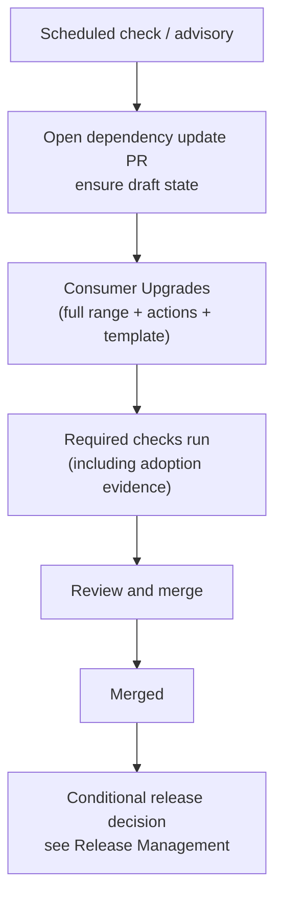

# Dependency Updates — Design

An automated updater implements the [spec](spec.md) through
`.github/dependabot.yml`. Review and merge controls govern its pull requests.

## What gets checked

| Kind | Trigger | Cadence |
| --- | --- | --- |
| **Version update** | A newer version of a pin exists | Scheduled, with a cooldown before a freshly published version is proposed |
| **Security update** | A published advisory affects a pin | On disclosure, out of band from the schedule |

## Coverage from manifests

The repository's manifests and definitions determine ecosystem coverage:

| Ecosystem | Identified by | Coverage path |
| --- | --- | --- |
| GitHub Actions | Workflow and composite-action definitions under `.github/` | Native updater |
| Containers | A container definition or a base-image reference | Native updater |
| Language packages | The ecosystem's manifest and lockfile at the directory root it governs | Native updater when supported |
| Infrastructure definitions | The module or provider constraint file for the tool in use | Native updater when supported |

The organization owns a **native-support catalog** and an **exception register**.
The catalog lists the ecosystems the platform-native updater supports.
Generation emits one updater entry per supported ecosystem and directory.
An unsupported manifest requires a central exception instead of an invalid native
entry. The exception records the manifest, directory, reason, and responsible owner.
It also identifies the shared, centrally managed mechanism that checks and proposes
updates.

Reconciliation compares every manifest with the generated native configuration and
the exception register. An additional ecosystem requires its manifest plus
regenerated native configuration or a central exception request.
A repository uses the organization's shared exception mechanism, not a
repository-specific updater. The exception remains visible until native support
exists.

## Cadence and cooldown

Schedule frequency and timezone are **organization configuration**, not constants.
The timezone determines when update proposals arrive relative to maintainer
working hours.

```yaml
schedule:
  interval: cron
  cronjob: "0 9 * * 1,3,5"
  timezone: <the organization's working timezone>
```

The **cooldown** delays a version update proposal after upstream publication.
During this delay, the upstream project can withdraw or replace a defective release
before update proposals reach consumers.

The organization standard is an implicit **three-day** cooldown for version updates.
Repositories omit `cooldown` when they use that standard.
An explicit mapping records a deliberate non-default duration.

Security updates bypass the schedule and cooldown. A published advisory identifies
a known vulnerability in the pinned version, so version-update delays do not apply.

## The updater

The updater opens **one PR per outdated or vulnerable dependency** with the
proposed reference change and upstream release context. SHA-pinned updates use the
target commit SHA with the version as a trailing comment.
Ecosystems, directories, and schedule use `.github/dependabot.yml`.
A non-default cooldown uses that file too. The standard three-day cooldown remains
implicit.



### Complete the adoption

The updater's proposal does not prove complete consumer adoption.
The author or delegated agent completes
[Consumer Upgrades](../../Ways-of-Working/Consumer-Upgrades.md) in the same delivery.
Establish the actual consumed source and fixed target. Inspect the entire
applicable range with full pagination and semantic/lineage ordering.
The newest embedded release note does not replace earlier releases in that range.

The procedure defines action composition, target-era template comparison,
preservation of consumer intent, and existing validation, including no-action
ranges. The update PR contains the reconciled evidence. If the updater omits
required context, retrieve equivalent authoritative producer evidence.
If that evidence is unavailable, register the gap and keep affected work blocked.
This adoption obligation uses the existing review path, not another updater.

### Release decision

Dependency changes are collected before any repository release decision is
made. When the target route invokes [Release
Management](../release-management/design.md), that capability resolves the
repository-wide effect. Otherwise the pull request omits the `Release decisions`
block and all `release:*` labels.

## Review and merge

Every automated update passes the repository's normal review and required-check
gates, including [complete consumer evidence](../../Ways-of-Working/Definition-of-Ready-and-Done.md#definition-of-ready-for-review).
Required migration work cannot be deferred while an incompatible reference change
merges. Automatic merge, where configured, never bypasses those gates.

Bind adoption verification to the
[required-check signal](../merge-automation/design.md#the-gate-a-ruleset-requires-the-checks)
before enabling automatic readiness, approval, or merge for update PRs.
An existing required PR validation check can own this condition.
A separate check is needed only when no existing check owns it. Missing or stale
range/ledger/template evidence keeps the result pending or failed, even when
build and test checks pass. Re-evaluate the result when the candidate or its
required evidence changes.

Create update PRs as drafts. If the native updater cannot create drafts, the
receiving workflow immediately converts each opened proposal to draft before it
requests human review. Keep each PR draft until the normal review-readiness gate,
including adoption verification, holds. The draft flag signals a review handoff.
It does not replace the binding required check or protect the
creation-to-conversion window by itself.

Update PRs remain outside automated readiness, approval, and merge unless the
required check enforces evidence verification. The platform updater supplies a
proposal, not proof that the gate has passed.

## Security updates

An advisory disclosure triggers a **prioritized** security update independently
of the schedule. The update follows the same review policy and any applicable
release path as another update.

## Configuration surface

| Surface | Where | Set by |
| --- | --- | --- |
| Native ecosystems and directories | `.github/dependabot.yml` | Generated from supported manifests |
| Unsupported ecosystems | Central exception register | Centrally managed shared mechanism |
| Schedule (`interval`, `day` and `time`, or `cronjob`) and `timezone` | `.github/dependabot.yml` | Organization configuration |
| Cooldown | Updater default (three days). Explicit mapping only for a deliberate non-default duration | Organization configuration |
| Release decision | Release Management, when invoked for the target route | Decided for the collected repository change |
| Merge policy | Branch protection and merge automation | Organization configuration |
| Security updates | Repository security settings | On by default |

For a *generated* surface, a difference between the committed configuration and
fresh output is drift. Generation MUST preserve surfaces marked
*organization configuration*, because those values record deliberate choices.

## Where this connects

- [Spec](spec.md) — dependency-update requirements.
- [Consumer Upgrades](../../Ways-of-Working/Consumer-Upgrades.md) — the procedure that turns an update proposal into verified adoption.
- [Repository Governance](../repository-governance/design.md#drift-detection-and-reconciliation) — the reconciliation that compares generated configuration against what is committed.
- [Release Management](../release-management/design.md) — the conditional release decision and output for an update pull request.
- [Downstream Release Propagation](../downstream-release-propagation/design.md) — the internal counterpart. Propagation PRs are dependency updates too.
- [GitHub Actions](../../Coding-Standards/GitHub-Actions.md#keep-pinned-actions-current) — the Action-pin specifics this builds on.
