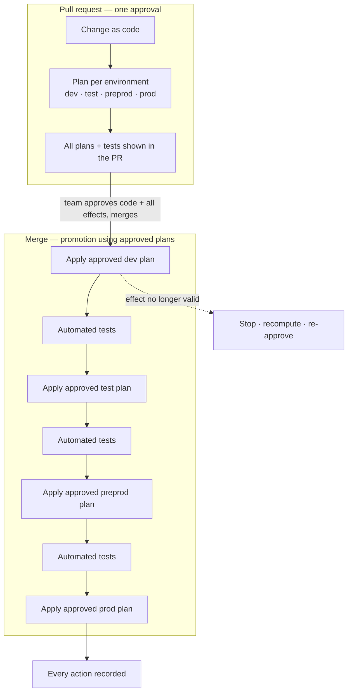

# Deploying Azure from GitHub

The deployment workflow satisfies the [Deployment spec](../spec.md) with
**Azure** (including Microsoft Entra ID) as the service provider, **GitHub** as
the CI/CD platform, and **Terraform (open source)** as the change engine. The
computed resource effect is a **saved Terraform plan**. Each environment has its
own remote Terraform state.

Other combinations use separate designs and the same spec. Examples include
deploying Azure from Azure DevOps, deploying AWS from GitHub, and deploying GitHub
from GitHub.

## Approach

Contributors propose changes through pull requests. The pull-request workflow
computes and shows the effect for **every environment in the promotion path**.
Approval and merge form the single decision on the code change and all these
effects ([FR2](../spec.md#fr2), [FR3](../spec.md#fr3)).

After merge, the workflow promotes the change through each environment in order.
It applies the **exact plans that were approved** ([FR4](../spec.md#fr4)).
Tests run between environments ([FR7](../spec.md#fr7)), and the workflow records
every action ([FR9](../spec.md#fr9)).



### Why this shape

- **One approval for the whole path.** The reviewer sees the effect on every
  environment. One approval covers all effects, so the design adds no
  per-environment reviewer gate, as the spec's non-goal requires.
- **Approved plans, not re-derived ones.** The saved plans reviewed on the pull
  request are the artifacts that promotion applies. The design rejects
  deployment-time re-planning because it can change the approved effect.

### Alternatives considered

- **Re-plan at deploy.** Rejected because a deployment-time plan can differ from
  the approved effect and fail [FR4](../spec.md#fr4).
- **Approve only the source diff, plan at deploy.** Rejected because the reviewer
  cannot inspect the effect before approval, which fails
  [FR2](../spec.md#fr2)–[FR3](../spec.md#fr3).
- **A required-reviewer gate on each environment.** Rejected because one approval
  covers all environment effects. Additional gates add no decision.

## Components

| Component | Role |
| --- | --- |
| **Reusable workflow** (`.github/workflows/terraform.yml`, `workflow_call`) | The provider-agnostic core runs init, format, validate, plan, render, policy scan, test, and apply. |
| **Plan (pull-request) workflow** | Computes `plan -out` for every environment in the path, renders it in the pull request, scans it, and uploads the plan artifact for approval. |
| **Promotion (merge) workflow** | Applies each approved plan in environment order and runs tests between environments. |
| **Azure identity step** | Uses `azure/login` for federated sign-in and sets `ARM_USE_OIDC=true` so the `azurerm` and `azuread` providers use the same token. |
| **State backend** | Stores state in Azure Storage per environment, with blob-lease locking and encryption at rest. |
| **Environments** | Defines GitHub Environments by environment name for the per-environment **identity boundary** and deployment branch policy, not as an approval gate. |
| **Break-glass workflow** (`workflow_dispatch`) | The emergency path. |
| **Drift job** (`schedule`) | Periodic `plan -detailed-exitcode` that opens an issue on drift. |

## The effect is a saved plan

Terraform uses a saved plan to bind approval to the deployment effect:

1. `terraform plan -out=tfplan.<env>` computes the effect against that
   environment's state and writes it to a file. The file pins provider versions
   and the state's **serial** and **lineage**.
2. `terraform show` renders the plan for people in a pull-request comment and as
   JSON for policy scanning. The process records `sha256(tfplan.<env>)`.
3. `terraform apply tfplan.<env>` applies **exactly** that effect. If the state
   has advanced, Terraform refuses the apply with `Saved plan is stale`. This
   state check is the native guard for [FR5](../spec.md#fr5).

## Review and approval

The pull-request workflow shows a plan for **each** environment in the promotion
path, with format, validation, policy, and test results. These are **required
checks**. A change cannot merge unless the workflow computes every environment's
effect successfully.

A branch ruleset on `main` requires review (CODEOWNERS for `**/*.tf`), dismisses
stale approvals on new commits, and requires up-to-date branches. The shown
effects therefore reflect current `main`. Approval and merge form the single
decision that the spec requires ([FR3](../spec.md#fr3)). The process retains the
approved plan artifacts for promotion.

## Promotion using the approved plans

After merge, promotion retrieves the plan artifacts approved on the pull request,
keyed to the merge commit. It performs the following steps for each environment
in order:

1. **Verify** `sha256(tfplan.<env>)` against the value recorded at plan time to
   prevent artifact substitution.
2. **Apply** `terraform apply tfplan.<env>` to deploy exactly the approved effect
   ([FR4](../spec.md#fr4)). If the plan is stale, the apply fails closed and
   promotion stops. The process produces a fresh plan and obtains approval again
   ([FR5](../spec.md#fr5)).
3. **Run tests** for the environment. A failing required test stops promotion
   before the next environment ([FR7](../spec.md#fr7)).

A concurrency group keyed per state **serializes** deployments against the same
state with `cancel-in-progress: false`. The state lock also prevents concurrent
applies to that state. An apply in progress is never canceled ([FR6](../spec.md#fr6)).

## Identity and access (OIDC)

- The workflow requests the GitHub OIDC token with `permissions: id-token: write`.
  `azure/login` federates on that token with the non-secret `client-id`,
  `tenant-id`, and `subscription-id`. No client secret exists ([NFR1](../spec.md#nfr1)).
- Azure federated credentials require the subject claim
  `repo:MSXOrg/Platform:environment:<env>`. This binds identity to the environment
  ([NFR3](../spec.md#nfr3)).
- Two identities serve each environment: **read-only** for effect computation
  and **write** for apply. The write identity is accessible only from that
  environment ([NFR2](../spec.md#nfr2)).
- The `azuread` provider manages Entra ID resources with the same federated token
  and Azure identity context. Entra ID needs no separate secret. To manage
  GitHub itself, the `github` provider uses a GitHub App installation token,
  never a personal access token.

## Break-glass path

The emergency path ([FR8](../spec.md#fr8)) is a `workflow_dispatch` "emergency
deploy". Required inputs are `reason`, `incident_id`, target environment, and a
typed confirmation. Only authorized operators have access.

It runs `plan -out` and shows the effect before `apply tfplan` deploys the
change. It retains the inputs and logs as an immutable run record. It opens a
follow-up issue that returns the change to the standard pull-request path.

No flag on the standard workflow skips review.

## Records and drift

Each run retains rendered plans, apply logs, and test results as artifacts and
logs. Each apply appears in the environment's deployment history, which provides
the audit trail for [FR9](../spec.md#fr9)/[NFR4](../spec.md#nfr4). A scheduled
`plan -detailed-exitcode` job detects drift and opens an issue
([FR10](../spec.md#fr10)).

## Interface

```yaml
# .github/workflows/terraform.yml (reusable — workflow_call)
on:
  workflow_call:
    inputs:
      environment:        { type: string, required: true }   # dev | test | preprod | prod
      working-directory:  { type: string, required: true }
      action:             { type: string, default: plan }    # plan | apply
      terraform-version:  { type: string, default: "1.9.x" }
```

The core is provider-agnostic. Azure sign-in is its only service-provider-specific
step. A different service provider (AWS) or CI/CD platform (Azure DevOps) uses the
same design structure with its own identity step. Each combination has its own
design under [Deployment](../index.md).

## Security boundaries and threats

- **Credential exposure** — only OIDC is used. No static cloud secret exists.
  The default token is read-only.
- **Plan artifact confidentiality** — saved plans can contain sensitive
  plaintext values. Retention is short, and access to artifacts is restricted.
  Sensitive variables and outputs are marked. Pull-request comments show
  scrubbed plan renders. Plan artifacts in a public repository are never exposed
  unscrubbed.
- **Artifact swap** — each apply verifies `sha256(tfplan.<env>)` before apply.
- **Cross-environment escalation** — federated subjects are pinned per
  environment. The write identity is accessible only from its own environment.
- **Stale apply** — Terraform's serial/lineage guard, deployment serialization,
  and branch-freshness rules protect against stale applies.

## Testing and operability

- **Run a dry run** of the full path on `dev`: pull-request plans for every
  environment, review, merge, and promotion with tests.
- **Exercise the stale path**. Change state between approval and deployment.
  Confirm that the apply fails closed.
- **Exercise break-glass** end-to-end. Confirm that the process opens the
  reconciliation follow-up and records attribution.

## Repository hardening

The repository pins third-party actions to commit SHAs and restricts allowed
actions. Secret scanning with push protection provides defense in depth under the
OIDC model.

## Decisions

One-way-door decisions are recorded here beside the spec, per
[Decision before change](../../../Ways-of-Working/Principles/AI-First-Development.md#decision-before-change).

- **Approve every environment's effect on the pull request; apply those exact
  saved plans on merge.** The design rejects re-plan-at-deploy because it can
  change the approved effect. Per-environment gates repeat the existing decision.
  Revisit this decision only if a saved plan can no longer bind review to
  deployment.

## References

- GitHub — security hardening with OpenID Connect: <https://docs.github.com/en/actions/security-for-github-actions/security-hardening-your-deployments/about-security-hardening-with-openid-connect>
- GitHub — configuring OIDC in Azure: <https://docs.github.com/en/actions/security-for-github-actions/security-hardening-your-deployments/configuring-openid-connect-in-azure>
- GitHub — managing environments: <https://docs.github.com/en/actions/how-tos/deploy/configure-and-manage-deployments/manage-environments>
- GitHub — reusing workflows: <https://docs.github.com/en/actions/using-workflows/reusing-workflows>
- GitHub — control concurrency: <https://docs.github.com/en/actions/using-jobs/using-concurrency>
- HashiCorp — automate Terraform with GitHub Actions: <https://developer.hashicorp.com/terraform/tutorials/automation/github-actions>
- HashiCorp — `terraform plan` / `terraform apply` (saved plan): <https://developer.hashicorp.com/terraform/cli/commands/plan> · <https://developer.hashicorp.com/terraform/cli/commands/apply>
- Terraform AzureRM provider — OIDC: <https://registry.terraform.io/providers/hashicorp/azurerm/latest/docs/guides/service_principal_oidc>
- Azure — `azure/login`: <https://github.com/Azure/login>
- Microsoft — GitHub Actions + Terraform OIDC on Azure sample: <https://learn.microsoft.com/en-us/samples/azure-samples/github-terraform-oidc-ci-cd/github-terraform-oidc-ci-cd/>
