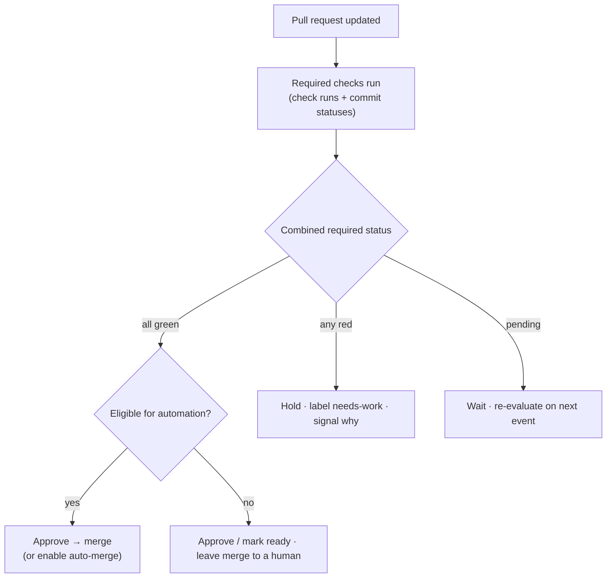

# Merge Automation — Design

Three GitHub platform components implement the [spec](spec.md):
the **named checks** a workflow publishes, a repository **ruleset** that requires
them, and a **GitHub App** that reads the combined result.
Automation relies on the checks rather than reviewing the diff.

## How a check reaches the pull request

Two mechanisms put a named check on a pull request, and a ruleset can require
either by its name or context:

| Mechanism | How it appears | Permission | Use it for |
| --- | --- | --- | --- |
| **Check run** | The job name, emitted automatically by Actions for every job | None beyond running the workflow | A signal that is one of the workflow's own jobs |
| **Commit status** | A context posted to the head commit via the [Status API](https://docs.github.com/rest/commits/statuses) | `statuses: write` | A signal that is not a whole job, or comes from outside Actions — an external CI system, or a tool that reports its own status |

The default is a check run. Actions publishes a check run for each named job.
Use a commit status only when the signal is not a whole job, such as a per-linter
status or an external result.
The authoring guidance for both is in
[Gate merges with a named status check](../../Coding-Standards/GitHub-Actions.md#gate-merges-with-a-named-status-check).

## The gate: a ruleset requires the checks

A repository **ruleset** (or branch protection) names the required checks.
A listed check holds the pull request until it passes. An unlisted check is
advisory. The required-check name and its job name or status context form one
contract. If one name changes, update the other in the same change.

## The automation

A **GitHub App** (or equivalent automation) is the actor.
It subscribes to the `check_suite`, `check_run`, and `status` webhook events or
reads the combined status for the head commit.
It evaluates whether every required context is successful, then acts on that
signal alone:

| Combined required status | Action |
| --- | --- |
| **All required checks pass** | Eligible pull request: approve and merge (or enable native auto-merge). Ineligible pull request: approve or mark ready, and leave the merge to a human. |
| **Any failure** | Hold. State the reason on the pull request (a label such as `needs-work`, or a comment). Never merge. |
| **Any pending** | Wait. Re-evaluate on the next check event. |

A missing required check holds the pull request. It is not a successful combined
result.

## Eligibility

Which pull requests may merge without a human mirrors the
[dependency-update policy](../dependency-updates/design.md#review-and-merge):
low-risk, well-labeled changes are eligible.
Changes that can break consumers, or that policy marks for review, require
human approval even when all required checks pass.
Configuration defines the eligible set and only **tightens** the gate.
Automation never merges a change that human review would hold.

## Prefer native auto-merge

Where possible, the app **enables GitHub's own auto-merge** instead of calling the
merge API. GitHub performs the merge after all required reviews and status checks
pass. Native auto-merge does not establish that `contents: write` is unnecessary.
GitHub's [documented auto-merge workflow](https://docs.github.com/en/code-security/tutorials/secure-your-dependencies/automate-dependabot-with-actions#enabling-automerge-on-a-pull-request)
grants that permission together with `pull-requests: write`.
Verify the app's selected operations against
[GitHub's permission guidance](https://docs.github.com/en/apps/creating-github-apps/registering-a-github-app/choosing-permissions-for-a-github-app#choosing-permissions-for-graphql-api-access).
The app requests only the permissions those operations require.

## Least-privilege permissions

The automation has only the permissions it uses:

| Scope | Why |
| --- | --- |
| `checks: read`, `statuses: read` | Read the required-check results. |
| `pull-requests: write` | Submit approving reviews and apply labels. The auto-merge operation can require additional permissions. |
| `contents: write` | **Only** when the selected merge or auto-merge operation requires it. |

GitHub defines [code owners](https://docs.github.com/en/repositories/managing-your-repositorys-settings-and-features/customizing-your-repository/about-code-owners#codeowners-syntax)
as users or teams with explicit repository write access.
App installation permissions do not establish that ownership.
An app's review does not itself prove that required code-owner approval is satisfied.
Automation waits for the ruleset's required review result.
Scope the app's approval to the eligible set the ruleset permits it to satisfy.

## Configuration surface

| Surface | Where |
| --- | --- |
| Which checks gate merge | Repository ruleset — required status checks |
| The check names / contexts | The workflows that publish them (job names / status contexts) |
| The eligible set (what may auto-merge) | The automation's configuration (labels / rules) |
| The actor's permissions | The GitHub App installation scopes |

## Where this connects

- [Spec](spec.md) — merge automation requirements.
- [GitHub Actions](../../Coding-Standards/GitHub-Actions.md#gate-merges-with-a-named-status-check) — authoring the named checks this consumes.
- [Dependency Updates](../dependency-updates/design.md) — the auto-merge policy this generalizes. Dependency update PRs are the canonical eligible set.
- [Release Management](../release-management/design.md) — the release a merge triggers on an invoked route.
- [Branching and Merging](../../Ways-of-Working/Branching-and-Merging.md) — pull-request-only integration and readable history.
