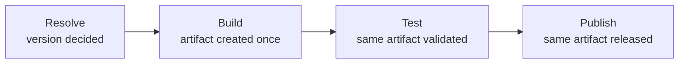

# Release Management — Design

The behavior in the [spec](spec.md) is delivered by shared release mechanics,
through a reusable workflow or a native producer pipeline. The effective
pipeline determines which routes produce versioned, immutable output consumed
by version. The optional `.github/release.config.yml` refines those settings;
its absence does not opt a managed route out.

## Applicability

Inspect the actual target route, including native producer pipelines, rather
than testing for a named shared workflow or the presence of a configuration file.
Managed routes evaluate release decisions and require pre-merge validation.
Routes without versioned release behavior omit release metadata and every
`release:*` label, including `release:skip`. A Pages deployment alone is not a
versioned release.

Verify the immutable producer revision's supported settings and owned-label
mapping. A differing released interface requires a verified adapter or a
producer/configuration migration before canonical signals are used; exact
adoption instructions belong in that producer's PR/release record. Missing
support blocks finalization and decision validation rather than making an
ignored label a successful skip or opting the route out.

## Branching model

A **release branch** is a branch assigned to one key in the `ReleaseType`
configuration object. The fixed keys are `Stable`, `Prerelease`, and
`ReleaseCandidate`; each key owns the properties for that release type,
including its `Branch`.

- **Single branch (zero-config).** `ReleaseType.Stable.Branch` always resolves:
  when `ReleaseType` or its `Stable` key is omitted, it uses the default branch.
  `Prerelease` and `ReleaseCandidate` are optional. Prereleases remain available
  from an open pull request through the mode label.
- **Multi-branch.** A full promotion path uses
  `ReleaseType.Prerelease.Branch` for early testing,
  `ReleaseType.ReleaseCandidate.Branch` for the promotable candidate, and
  `ReleaseType.Stable.Branch` for production. Each configured branch publishes
  only its keyed release type. Promotion to `ReleaseType.Stable.Branch` computes
  from the latest stable release plus the merge pull request's resolved bump;
  prerelease and release-candidate counters do not carry over.
- **One branch per type.** Each release-type key has at most one `Branch`, and
  the same branch MUST NOT appear under more than one key. Unknown keys and
  duplicate branch assignments are rejected.
- **One production authority.** `Stable.Branch` is the only branch that cuts a
  stable release. A prerelease or release-candidate branch can never publish the
  production version.
- **Bundled releases.** A **staging branch** collects feature PRs; merging it to
  a release branch produces **exactly one** release for all bundled changes.

```yaml
# .github/release.config.yml
DefaultBump: patch
ReleaseType:
  Stable:
    Branch: main
  Prerelease:
    Branch: dev
  ReleaseCandidate:
    Branch: rc
```

## The pipeline

Every release runs the same four stages in order. The stage boundaries exist to
make **build-once** enforceable — each stage may only consume what the previous
stage produced.



| Stage | Produces | Invariant |
| --- | --- | --- |
| **Resolve** | the version | the version is known before anything is built, so it can be baked in |
| **Build** | the artifact | the artifact is created exactly **once**, carrying its version |
| **Test** | a verdict | validation runs against the built artifact, not a rebuild of its source |
| **Publish** | released versions | the artifact is transferred unchanged to every target |

Two consequences follow, and they are the point of the model:

- **The version is identity, not metadata.** Because Resolve precedes Build, the
  version is embedded in the artifact rather than attached to it. A manifest
  version, an image label, and the tag agree because they came from one decision.
- **Recovery preserves artifact identity.** Retrying validation or publication of
  an unchanged, already-built artifact reuses that artifact and its resolved
  version. A correction that changes the output is a new release: it resolves a
  new version and builds new bytes. An artifact is never patched, re-tagged, or
  rebuilt under an existing version — that would publish something other than what
  was tested.

## Version computation

For PR-driven releases on a managed route, the shared resolver reads the owned
labels and effective settings. It records the chosen bump, mode, and the input
that supplied each decision before Build.

### Settings and caller overrides

Follow [Smart defaults, local overrides](../../Ways-of-Working/Principles/Software-Design.md#smart-defaults-local-overrides):
shared defaults are overridden by repository settings in the optional
`.github/release.config.yml`, then by explicitly supplied supported caller
inputs for that invocation. Omitted caller inputs preserve repository settings;
they do not overwrite them with an input's default. The implementing workflow
or action documents its exact supported caller surface and validates it through
the same settings resolver rather than maintaining another algorithm.

`DefaultBump` accepts exactly `patch`, `minor`, or `major`. Its documented shared
default is `patch`; omitting the configuration file or field inherits that value.
Unknown setting names, null or empty values, and values outside the documented
set fail validation, even when a narrower override or bump label exists.

| Setting | Shared default | Repository override | Supported caller override |
| --- | --- | --- | --- |
| `DefaultBump` | `patch` | `DefaultBump` in `.github/release.config.yml` | Explicitly supplied caller override supported and documented by the invoked producer for this setting. |

A repository can select minor as its normal level without requiring a minor
label on every publishing PR:

```yaml
# .github/release.config.yml
DefaultBump: minor
```

| Label | Meaning | Valid combination |
| --- | --- | --- |
| `release:patch` | Resolve the next patch version, overriding the effective default. | Alone or with `release:prerelease`. |
| `release:minor` | Resolve the next minor version, overriding the effective default. | Alone or with `release:prerelease`. |
| `release:major` | Resolve the next major version, overriding the effective default. | Alone or with `release:prerelease`. |
| `release:prerelease` | Publish the open pull request as a prerelease using the resolved bump. | With one explicit bump or the effective default; never with `release:skip`. |
| `release:skip` | Run validation without resolving or publishing a version. | Alone. |

Resolve the decision in this order:

1. Validate supplied settings and the effective configuration, then reject
   conflicting owned labels. An invalid setting is an error even when another
   input would supply a valid level. Bare and unrelated labels do not participate.
2. Honor a valid `release:skip` as the explicit no-release decision and stop bump
   resolution.
3. Use the single owned bump label when present; otherwise use the valid
   effective `DefaultBump`. Record whether the label, caller input, repository
   setting, or shared default supplied the level.
4. If neither resolves a valid level, fail with an actionable decision error.
   Inheriting the documented patch default is a valid policy decision; choosing
   patch to recover from invalid or unresolved input is forbidden. Prerelease
   mode does not supply a bump.

| PR input | Effective default and source | Decision-check result |
| --- | --- | --- |
| `release:major` | Valid `patch` from any supported scope | Pass: explicit major overrides the default. |
| No owned release labels | No repository or caller override; shared `patch` | Pass: documented patch default; no per-PR bump label required. |
| No owned release labels | Repository `minor`; caller omitted | Pass: repository minor; record the setting as the source. |
| No owned release labels | Repository `major`; explicit caller `patch` | Pass: caller patch overrides repository major. |
| `release:skip` alone | Valid default | Pass: no release; no bump is required. |
| `release:prerelease` alone | Valid effective `minor` | Pass: default minor in prerelease mode. |
| No bump label | No valid effective default can be resolved | Fail: unresolved decision; no invented fallback. |
| Multiple bump labels, or skip with another owned release label | Any | Fail: conflicting decisions; no fallback. |
| Any, including an explicit bump or skip | Invalid supplied setting | Fail: invalid configuration; no fallback or masking by an override. |

- **First release** uses `0.0.0` as the version base when no stable history
  exists. The resolved patch, minor, or deliberate major bump produces
  `0.0.1`, `0.1.0`, or `1.0.0`, respectively. Pre-`1.0.0` breaking changes
  use minor per [SemVer §4](https://semver.org/#spec-item-4); reaching `1.0.0`
  is a deliberate major decision, never an auto-detected breaking classification.
- The tag is created on the commit now at the head of the release branch —
  squash, merge-commit, and rebase strategies alike.

### Required pre-merge decision check

PR CI runs the resolver read-only against the candidate release settings,
supported caller inputs, and current owned labels, without creating tags,
releases, or published artifacts.
An existing version-resolution check may own this validation; do not duplicate
the resolver. The check reports the effective decision and its source, not a
promised final stable version.

The validator runs for every PR targeting a managed release route, including
native producer routes, changes that will not publish, and repositories without
a release configuration file. It re-runs when source, release labels, release
settings, supported caller inputs, or the effective pipeline changes, so a stale
result is not evidence for different inputs. Missing,
invalid, or conflicting decisions produce a failed check with an actionable
error. A valid skip reports success with a no-release result; path filters do
not skip the validator.

Configure the check's exact name as required in the protected branch's ruleset
or branch protection, following [Merge Automation](../merge-automation/spec.md).
Manual merge and auto-merge both wait for it: failure, pending execution, and
absence block merge. A warning or an advisory, unrequired check is insufficient.
Human review still assesses whether the resolved level matches the audience
impact; CI validates the deterministic decision contract.

The release run validates its actual inputs again before Resolve and Build.
Pre-merge validation does not replace release-time validation, but a known
missing decision is never deferred until after merge.

### Optional ad hoc releases

The standard release path is a pull request with a validated decision merged into a release
branch. `workflow_dispatch` is an optional extension, not part of the minimum
implementation. An implementation SHOULD omit it unless its product has a real
need to release already-reviewed content outside the merge flow.

Where an ad hoc path exists, it requires an explicit bump, source ref, complete
release-note context meeting the [release evidence contract](#release-notes), and
reason. It resolves the source ref to an immutable commit and enters
the same Resolve → Build → Test → Publish pipeline as a merged pull request. It
does not infer a bump, bypass validation, rebuild an existing version, or make a
direct push into a release interface.

Do not create an empty pull request to manufacture a release. It contains no
artifact-affecting change and makes the review trail imply a change that did not
happen. Retrying failed validation or publication is not an ad hoc release
either: rerun the existing release with the same artifact and version under the
[recovery rule](#the-pipeline).

## Prereleases and release candidates

- **Prerelease branch** — `ReleaseType.Prerelease.Branch` publishes on every
  push, using the branch name as the identifier: `v1.3.0-dev.1`,
  `v1.3.0-dev.2`, …
- **Release-candidate branch** — `ReleaseType.ReleaseCandidate.Branch` publishes
  `v1.3.0-rc.1`, `v1.3.0-rc.2`, … and never promotes one to latest.
- **PR-level** — `release:prerelease` on an open PR publishes
  `v<base>-<identifier>.<counter>`: `base` is the next version from one explicit
  owned bump label when present, otherwise from the resolved `DefaultBump`;
  `identifier` is the normalized branch name, and `counter` auto-increments per
  push.
- Artifact-specific conventions replace the SemVer suffix where they exist
  (`-alpha.N` for npm, `.devN` for Python).
- **Cleanup** deletes prerelease tags, releases, and artifacts after the PR
  closes (configurable); stable releases are never touched.

## Path filtering

`.github/release.config.yml` declares `release-paths` as ordered include/exclude
globs (excludes win). The workflow **always runs** so validation executes on
every merge; only the release step is skipped when no artifact-affecting path
changed.

Derive these paths from the delivered product and its
[audience-facing contracts](../../Ways-of-Working/PR-Format.md#identify-the-readers),
not directory names alone. Include callable workflows and build configuration
that changes delivered runtime requirements or behavior. Do not retain an
exclusion that overrides an included consumer interface or artifact input.

This example represents a workflow producer with a public `reusable.yml` entry
point and its local implementation; each producer lists its own artifact inputs.

```yaml
release-paths:
  - ".github/workflows/reusable.yml" # public caller contract
  - ".github/actions/**"            # this workflow's local implementation
  - "src/**"
```

## Release notes

The GitHub Release **name** is the resolved version. Its **body** preserves the
release-bound PR title and complete description, using
[PR Format](../../Ways-of-Working/PR-Format.md#write-the-description) as the
authoring contract. The leading summary, single boundary, non-empty classified
results, scoped supporting evidence and related references, and conditional
release-decision block stay intact. There is no parallel JSON/YAML contract or
extraction of only selected headings.

Each release explains the complete delivered delta from its identified baseline:
what changed, why, affected supported uses, compatibility, and exact actions
with prerequisites, ordering, and verification, or an explicit no-action result
with its compatibility basis. Required old-to-new instructions stay in the note,
not repository migration guides or a parallel changelog.

Reading all applicable records after the actual consumed baseline through the
target is sufficient to compose the actions. A later record explains superseded
actions while preserving required intermediate operations. Reading a record does
not require installing that version unless its instructions explicitly require
an intermediate installation or run. PRs and diffs provide optional depth;
missing required instructions are evidence gaps, not implicit no-action results.
Resource docs describe supported target-state behavior and usage.

Each result's prose and examples hold the consumer's instructions; its technical
details hold the supporting evidence. Internal-only work without a classified
section puts the action or no-action result in the summary and the applicable
evidence in the supporting block after its boundary.

### Bind the note to the released source

1. **Resolve the evidence with the version.** Identify the release-bound PR or
   ad hoc context and the immutable source to build. Resolve the version base
   and the source comparison baseline; reconcile every delivered consumer delta,
   including earlier merged or skipped changes, and confirm the complete
   adoption actions or supported no-action result. Capture the applicable title and complete body together
   with the PR URL or context reference, source identity, and snapshot time.
   Retain that snapshot as release evidence.
2. **Keep identity separate from authored prose.** Resolve the actual publication
   coordinates through the existing version pipeline, not a number assigned by
   the PR author. Carry them and the snapshot through Build and Test with the
   same artifact. An authored statement that coordinates resolve at publication
   is not replaced with a manual prediction.
3. **Publish the complete record.** Preserve the captured title and body
   unchanged, with a clearly separated publication envelope. Compare the
   published authored portion with the snapshot; truncation, summarization,
   missing evidence, or a source mismatch is a publication failure, not success.
   Hand the same complete record to every note-bearing publishing target and
   [Downstream Release Propagation](../downstream-release-propagation/design.md).

The envelope records these resolved facts without becoming a second authored
release note:

| Field | Value |
| --- | --- |
| Release identity | Actual version, stable/prerelease mode, tag, immutable source commit, and artifact identity or digest where applicable. |
| Effective decision | The resolved semantic effect and its owned-label or configured-policy source; [version computation](#version-computation) remains authoritative. |
| Version base | The actual version/source used to compute the version, or the explicit initial versioning baseline. |
| Change baseline | The release and immutable source against which the consumer delta is described, plus a source comparison link; explicitly no predecessor for an initial release. |
| Note provenance | Release-bound PR URL or ad hoc context, its associated source identity, and snapshot time. The retained authored snapshot is the content reference, not the PR's later mutable body. |

Version base and change baseline can differ, particularly for prereleases and
bundled promotion. Recording both avoids presenting a versioning calculation as
proof of the code a consumer crosses. The target template identity and
compatibility evidence come from the authored record; a publisher does not
substitute the latest template or infer historical compatibility from current
documentation.

### Release-bound records

| Publication path | Authored record |
| --- | --- |
| Single merged PR | That PR's complete title and description, reconciled with the resolved source comparison. |
| Bundled release | The integration PR retains every consumer delta and required action from the declared change baseline, including skipped changes, grouped by result; contributing work provides optional depth. |
| Optional ad hoc dispatch | Complete reviewed release-note context with the same classified structure and applicable result-scoped evidence. Record source and reason; do not create or imply an empty PR. |
| Prerelease | The PR or integration record appropriate to that published source, captured for that release. Later edits to the final PR do not overwrite the prerelease snapshot or attribute unreleased behavior to it. |

If the relationship between a record and its source cannot be established, or
required consumer instructions are missing,
stop the affected publication and register the evidence gap. The process does
not substitute the newest note, guess a baseline, or treat an empty adoption
section as a no-action result.

### Correct published metadata without changing history

A note correction is an audited metadata operation, not another release run:

1. Establish the release-to-source and PR relationship from immutable source
   comparisons and contemporary evidence. Preserve source-specific prerelease
   records rather than copying a later final-PR body over them.
2. Capture original and proposed content, reason, evidence links, actor, and
   time in a linked audit issue or durable attached artifact. Coordinate active
   PR ownership; do not add closing keywords to audit prose.
3. Re-read each target before writing. If another edit changed it, reconcile the
   correction rather than overwriting that edit. Apply only the established
   PR/release metadata changes and retain their correspondence.
4. Re-read the result and confirm that the correction changes no artifact,
   asset, tag, SHA, release decision, or behavior attributed to an old version.
   Record unverifiable facts as unresolved gaps instead of inventing actions.

The audit belongs in GitHub issues and release/PR metadata, not a product
documentation changelog. A correction to bytes still follows the
[new-artifact recovery rule](#the-pipeline); editing notes never bypasses it.

## Release output

1. A git tag `vX.Y.Z` on the release-branch commit — always.
2. The published artifact where one lives outside git — a container image
   (`<image>:<version>` and `@<digest>`), a package in its registry. For Action,
   workflow, and module artifacts the tag itself **is** the artifact.
3. A GitHub Release whose name is the version, carrying the note and the
   publication envelope, including the tag's resolved source commit and the
   immutable artifact identity.

## Publishing targets

Publish is the only stage that knows where an artifact goes, and it reaches every
destination through one abstraction: a **publishing target**. A target is any
destination that accepts a versioned artifact and serves it to consumers — the
GitHub Release itself, a package registry, an extension marketplace, a container
registry.

The release process is written against the target *contract*, never against a
specific target. Each target documents how it answers six questions — version
scheme, prerelease representation and sort order, immutability, unpublish
behaviour, floating-tag support, and where its release record lives — in
[Publishing Targets](design-publishing-targets.md). Adding a destination means
writing that contract and a publish step; it does not change Resolve, Build,
Test, or the spec.

Where a repository has more than one target, publishing is **all-or-nothing** for
a version:

- Targets are attempted in a defined order, and each is idempotent — publishing
  an already-published version is a success only when it identifies the same
  immutable artifact. A version collision with different bytes is an error, so a
  re-run completes the set rather than accepting changed output.
- A target that rejects the version fails the release. The version is not
  advertised as available until every target holds it.
- A partial publication resumes Publish for the **same** artifact and the same
  version. It never resolves a new version to work around a single failed target,
  because the targets that already succeeded hold that immutable version.

## Floating tags

Floating tags are optional, mutable pointers published alongside the immutable
version tag, for consumers that want to track a line rather than a point:

| Tag | Points at | Moves when |
| --- | --- | --- |
| `latest` | the newest stable version | any stable release |
| `vMAJOR` | the newest stable version in that major | a stable release within that major |
| `vMAJOR.MINOR` | the newest stable patch in that minor | a stable patch within that minor |

Three rules keep them safe:

- **Prereleases never move a floating tag.** Only a stable release advances one,
  so a floating tag never points at something not promoted for adoption.
- **A floating tag never moves backwards.** It only advances, so a consumer
  following it never silently downgrades.
- **Only controlled release automation moves a floating tag.** Humans and ad hoc
  workflows do not create or repoint one. The automation publishes the immutable
  version first, then moves only the aliases that release is eligible to advance.
- **A major tag stays inside its compatibility line.** `vMAJOR` advances only
  for compatible stable patch and minor releases in that major. A breaking
  release creates the next major tag and leaves the previous one in place.
- **Floating tags are controlled references only for owned automation.** An
  organization- or initiative-owned Action or reusable workflow may be consumed
  through its controlled `vMAJOR` tag. External automation and anything requiring
  byte-for-byte reproducibility pins to the immutable version, digest, or SHA
  ([supply chain](../../Coding-Standards/Security.md#supply-chain)).

## Serialised releases

Release runs for the same ref are **serialised** and **queue rather than
cancel** — an in-flight release is never aborted mid-write, since it may be
part-way through creating a tag or pushing an artifact. The shared workflow
declares a concurrency group keyed by workflow and ref, with
`cancel-in-progress` disabled:

```yaml
concurrency:
  group: ${{ github.workflow }}-${{ github.ref }}
  cancel-in-progress: false
```

Serialisation is provided once by the reusable workflow so every repository
inherits it; the mechanism is the
[GitHub Actions standard](../../Coding-Standards/GitHub-Actions.md#concurrency).
The single-stable-branch rule above is what keeps the production version under
one authority — `ReleaseType.Stable.Branch` is the only ref that ever cuts a
production release, and its runs are serialised like any other.

## Configuration surface

| Surface | Where |
| --- | --- |
| Release Management applicability | effective target-route pipeline, including shared workflows and native producers |
| Release types + branch mapping | `ReleaseType` in `.github/release.config.yml` |
| Default bump and overrides | documented shared `DefaultBump: patch`, repository settings, then supported caller inputs |
| Explicit bump / prerelease / skip | `release:` PR label |
| Pre-merge decision validation | named PR check required by the branch ruleset or protection |
| Optional ad hoc release | `workflow_dispatch` inputs |
| Path filter | `.github/release.config.yml` |
| Prerelease cleanup toggle | release config / workflow input |
| Publishing targets | reusable-workflow input + GitHub environment; see [Publishing Targets](design-publishing-targets.md) |

## Where this connects

- [Spec](spec.md) — the requirements this design delivers.
- [Publishing Targets](design-publishing-targets.md) — the contract each destination documents.
- [Downstream Release Propagation](../downstream-release-propagation/design.md) — consumes the release note and immutable reference.
- [GitHub Actions](../../Coding-Standards/GitHub-Actions.md) — how the workflow itself is authored (SHA pins, least privilege, concurrency).
- [Security](../../Coding-Standards/Security.md#supply-chain) — why consumers pin to immutable references.
