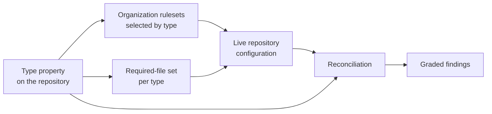

# Repository Governance — Design

Three components deliver the [spec](spec.md): a **property**, **organization
rulesets**, and **reconciliation**. The property carries the declaration.
Organization rulesets read it, and reconciliation compares live configuration
with the declared requirements.

Delivery records provide evidence that an implementation and its enforcement
satisfy the reconciliation contract.

The declaration is the only per-repository input that selects controls. The
organization maintains shared control definitions rather than duplicating them
per repository
([NFR1](spec.md#non-functional)).

## The declaration

The type is a **multi-select** organization custom property, required on every
repository, defaulting to the Standard value. A multi-select property separates
branch-model and layering obligations
([FR2](spec.md#classification), [repository types](design-types.md)).

The property mechanism — how conditions target it, why conditions are written as
exclusions, and how an existing condition is migrated onto it without dropping
coverage — is owned by [Repository Type
Property](../../Ways-of-Working/Repository-Type-Property.md).

Moving an organization from a single-select property to a multi-select `Type`
property is a schema change the platform does not perform in place. The migration
uses a uniquely named temporary multi-select property to keep every control
covered while the canonical name is recreated; the precise sequence and API
semantics are owned by [Repository Type
Property](../../Ways-of-Working/Repository-Type-Property.md#migrating-from-a-single-select-property).
Coverage is verified by asking the platform which rules apply to each repository
rather than by reasoning about condition JSON.

## Rulesets by type

Each governed concern has one organization-level ruleset selected by type.
A repository-level copy would duplicate the control
([NFR1](spec.md#non-functional)).

| Ruleset | Selects | Branches | Enforces |
| --- | --- | --- | --- |
| **Baseline protection** | Every type except Unmanaged | Protected branches | No deletion, no force-push, required checks |
| **Pull-request gate** | Every type except Unmanaged | Protected branches | Pull request required |
| **Artifact history** | Type includes Artifact | Default branch or Infrastructure integration branch | Squash-only merge, linear history required |
| **Promotion — integration** | Type includes Infrastructure | Integration branch | Squash-only merge |
| **Promotion — production** | Type includes Infrastructure | Production branch | Merge-commit only, promotion-source check required |
| **Documentation build** | Type includes Docs | Protected branches | Documentation-build check required |
| **Automated review** | Every type except Unmanaged | Default branch | A review is requested on every pull request; advisory, not a gate |

Two properties of this table matter more than its contents:

- **Conditions are exclusions, not allow-lists.** Each ruleset matches every repository and then subtracts the types that must be exempt. A type value invented later is covered by default; only a type an administrator has explicitly named ever loses coverage ([NFR5](spec.md#non-functional), [filter by exclusion](../../Ways-of-Working/Repository-Type-Property.md#filter-by-exclusion-not-by-inclusion)).
- **Rulesets layer rather than override.** A repository matching three rulesets is subject to the union of all three. Nothing needs to know what else applies, which is why a layering type can be added without touching a branch-model ruleset.

Automatic deletion of a merged pull request's head branch is not a ruleset rule.
Reconciliation verifies the repository-level `delete_branch_on_merge` setting for
every governed repository instead. Unmanaged is the sole type that removes the
baseline.

Bypass is granted on each ruleset to a **named administrative group in
pull-request mode only** — never to individuals, and never as a blanket write
exception ([FR16](spec.md#bypass)).

## Organization defaults repository

Each organization has one public repository named `.github`. It is the
initiative's community repository and the normal source for shared contribution
guidance. It has three distinct purposes: inherited community files, published
organization-profile content, and local context for the defaults repository.
These are not one distributable file set. Repository-specific configuration
stays local to the defaults repository.

The defaults-repository contract for the
[MSXOrg defaults repository](https://github.com/MSXOrg/.github) and the
[PSModule defaults repository](https://github.com/PSModule/.github) uses this
structure:

| Surface | Status | Behavior |
| --- | --- | --- |
| `.github/CODE_OF_CONDUCT.md` | Required | Inherited by a repository that has no local code of conduct. |
| `.github/SECURITY.md` | Required | Inherited by a repository that has no local security policy. |
| `.github/SUPPORT.md` | Required | Inherited by a repository that has no local support policy. |
| `.github/CONTRIBUTING.md` | Required | Owns the initiative's shared contribution guidance. The source file must exist but may be blank; consumer-local guides remain conditional. |
| `.github/ISSUE_TEMPLATE/` | Optional | Provides the organization's issue forms and template configuration where a repository defines no local issue-template set. |
| `profile/README.md` | Optional | Publishes the public organization profile; it is not inherited by repositories. |
| `media/` | Optional | Holds assets used by the profile or community files; it is not inherited by repositories. |
| `README.md`, `AGENTS.md`, client routes, `.gitattributes`, and `.gitignore` | Required locally | Explain and govern the defaults repository; they are not organization defaults. |

All inherited community files live under `.github/` in the defaults repository
so their scope is visible from their path. Validate required defaults in that
source repository, not by requiring consumer copies. A target retains a local
community file only for genuine repository-specific content or a documented
exception under [Organization Standard](../../Ways-of-Working/Organization-Standard.md#community-files-are-organization-defaults).
For the required contribution source, verify file presence, not a nonempty body.
If a target defines any local issue-template set, it owns that complete set
rather than combining local and central forms.

[GitHub's fallback](https://docs.github.com/en/communities/setting-up-your-project-for-healthy-contributions/creating-a-default-community-health-file)
exposes supported defaults without placing them in consumer clones, packages,
or downloads. Consumer checks resolve the effective contribution guidance from
the local guide when needed or the shared source; absence of an unnecessary
local copy is not drift.

The contract provides no PR-template-file surface to inherit or distribute. Ordinary and
defaults repositories follow the [Repository Standard's file
policy](../../Ways-of-Working/Repository-Standard.md#no-pr-template-files).
PR authoring evidence verifies the actual title, complete body, and source
coverage against that contract, not a source scaffold's presence. Product
integration templates and the other community defaults retain their own
ownership.

The defaults repository does not centralize repository ownership, dependency
updates, release configuration, license terms, or other repository-specific
configuration. Those files remain in each target repository because either
their values vary by repository or the platform does not inherit them.

Client routes are also repository-specific. In particular,
`.github/copilot-instructions.md` in the defaults repository routes Copilot for
that repository only; it is not an organization-wide file default.
Organization-wide Copilot instructions are configured through the organization
settings and point to the same canonical standards rather than copying them.

### The promotion-source check

Branch protection can require a check; it cannot express "only from this branch".
So the constraint is implemented as a check that reads its own pull request's head
branch and fails unless it is the integration branch. Being a required check, it
inherits everything the merge gate already provides: it blocks the merge, it is
visible on the pull request, and it is bypassable only by the group the ruleset
names.

## Required files by type

The [Repository Standard](../../Ways-of-Working/Repository-Standard.md#required-files)
owns the file list, its conditional contribution rule, and which type adds to
it. Reconciliation checks required local files on the default branch and
resolves effective contribution guidance under
the [contribution rule](../../Ways-of-Working/Repository-Standard.md#contribution-guidance), at
**Block** severity for the files that make a repository contributable and
**Report** severity for the rest.

## Drift detection and reconciliation

Rulesets constrain branch changes. They do not prevent all configuration drift.
Configuration changes can rename a required check, re-enable a merge method,
remove a required file, or invalidate a type combination.
**Reconciliation continuously compares declared requirements with live
configuration and grades every difference.**

The loop combines scheduled comparison with a graded response. An administrative
workflow, an application that holds the organization's configuration, or a policy
engine can implement it. Each implementation must satisfy the contract below.

### What is compared

| Comparison | Question |
| --- | --- |
| Type is set | Does the repository carry a type value at all? |
| Type is valid | Is every value in the organization's allowed list? |
| Type composes | Is the combination valid ([validation rules](design-types.md#validation-rules))? |
| Exemption is justified | Does an exempted repository carry a recorded reason? |
| Rulesets apply | Do the rulesets the type implies actually evaluate against this repository? |
| Branch shape matches | Do the protected branches, merge methods, and required checks match what the type declares? |
| Required local files present | Does the default branch carry the locally required baseline and type-specific files, or the explicit Unmanaged discoverability minimum, including a local contribution guide only when needed? |
| Contribution guidance available | Does effective local or shared contribution guidance resolve, with required organization defaults validated in their source repository rather than copied into consumers? |
| PR authoring and file policy | Are PR-template files absent under the [Repository Standard](../../Ways-of-Working/Repository-Standard.md#no-pr-template-files), and do actual records meet [PR Format](../../Ways-of-Working/PR-Format.md#check-readiness) with verified source coverage and supporting evidence? |

### Severity decides the response

| Severity | Meaning | Response |
| --- | --- | --- |
| **Block** | The declaration is unusable or the repository is not contributable | A failing check on the change that introduces it |
| **Warn** | Live configuration diverges from the declaration but the repository still functions | A comment on the affected pull request |
| **Report** | A standing condition that needs review rather than an immediate fix | A tracking issue, opened once and updated thereafter |

Separate responses distinguish blocking conditions from findings that need only
review. A single severity would either block those review-only conditions or
merely report conditions that require a block.

### When it runs

Reconciliation runs on repository creation, type-property changes, default-branch
pushes, and a schedule. Default-branch pushes trigger file comparisons. The
schedule detects configuration changes outside these event paths.

### Idempotence

Reconciliation reports the same finding at most once. A finding is identified by
its repository, comparison, and specific difference. A later run **updates** an
existing finding rather than creating a second one. Reconciliation closes the
finding when its condition is resolved ([FR20](spec.md#reconciliation)).
This keeps recurring findings distinct from new ones.

### A finding names its remedy

Every finding states what is wrong, what the declared type requires instead, and
where the rule is documented. Human and agent recipients can use that information
to act on the finding ([FR21](spec.md#reconciliation)).

Reconciliation **reports** by default. Applying a remedy is a separate
per-comparison decision and MUST be deliberate. An automated protection change
changes a control and requires the same review as any other control change
([decision before
change](../../Ways-of-Working/Principles/AI-First-Development.md#decision-before-change)).

## Configuration surface

| Setting | Where |
| --- | --- |
| Allowed type values | Organization custom-property schema |
| Which controls a type implies | Organization rulesets |
| Required approvals per type | Organization rulesets |
| Bypass group | Organization rulesets |
| Organization community defaults | Public organization `.github` repository |
| Organization-wide Copilot instructions | Organization Copilot settings |
| Required-file set per type | [Repository Standard](../../Ways-of-Working/Repository-Standard.md#required-files) |
| Comparison severities | Reconciliation configuration |
| Reconciliation schedule | Reconciliation configuration |

## Where this connects

- [Spec](spec.md) — repository governance requirements.
- [Repository Types](design-types.md) — the catalog the rulesets select on.
- [Repository Type Property](../../Ways-of-Working/Repository-Type-Property.md) — the property mechanism and condition migration.
- [Repository Standard](../../Ways-of-Working/Repository-Standard.md) — the required-file sets reconciliation checks.
- [Branching and Merging](../../Ways-of-Working/Branching-and-Merging.md) — the merge gate and who may approve.
- [Automation Labels](../../Ways-of-Working/Automation-Labels.md) — the namespaced labels reconciliation and the rulesets rely on.
