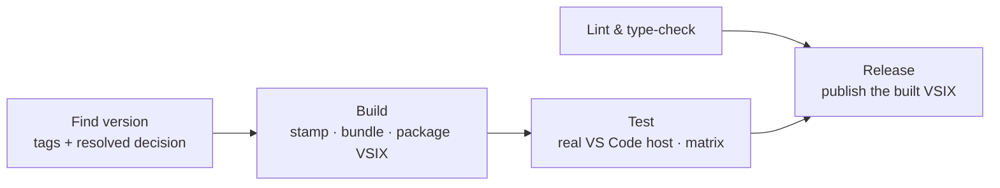

# VS Code Extension Framework — Design

The framework combines a **shared reusable workflow** with a **template repository**
to meet the [spec](spec.md). It follows the
organization's `Process-*` / `Template-*` convention, which
[Process-PSModule](https://github.com/PSModule/Process-PSModule) uses for PowerShell
modules.

A repository opts in with a short caller workflow and a single
`.github/vscode-extension.yml` extension settings file. Build and test settings
have secure, working defaults. Release decisions follow
[Release Management](../release-management/design.md#version-computation).

Versioned scripts contain the step logic. The workflow calls those scripts
instead of inline shell.

## The pipeline

The pipeline stages form a directed acyclic graph (DAG). Each stage has one
purpose. Downstream stages use the exact outputs of the preceding stages:

- **Find version** — validates the release decision and computes the version
  once. It uses the shared release resolver's authoritative version base and
  valid effective bump, not a separate latest-tag algorithm. It resolves the
  canonical release identity and any declared native numeric mapping before
  Build. It retains both with their source evidence. The stage has no upstream
  dependency. The merge ruleset requires this check; a missing decision fails it.
- **Lint & type-check** — runs static analysis and the type checker. This
  independent stage runs in parallel with the build and reports errors early.
- **Build** — stamps the resolved native extension version into the manifest,
  compiles the production bundle, and packages **one** VSIX. It uploads the
  bundle, the VSIX, and the stamped manifest as artifacts.
- **Test** — downloads a real editor host and runs the extension test suite
  against the exact bundle and manifest from Build.
- **Release** — publishes the exact VSIX that was built and tested. It depends
  on both `test` and `lint`.

## The built-once contract

The pipeline computes the version once and passes the build artifacts between
stages. Release publishes the same VSIX that Build packages:

1. **Find version** decides the canonical release version and validated native
   extension version together, before Build.
2. **Build** stamps the resolved native version into `package.json` (and
   `package-lock.json`), compiles
   the bundle, and runs the packaging CLI to produce a single VSIX. Build uploads
   the stamped manifest with the VSIX. The test job uses that manifest, including
   the version that the running extension reports. The manifest under test
   matches the packaged artifact.
3. **Test** restores and tests the exact bundle and stamped manifest from Build.
4. **Release** restores and publishes the same VSIX from Build. The GitHub
   Release uses the canonical identity and records the native mapping. Enabled
   marketplaces receive the unchanged VSIX and the corresponding native
   version/channel.

After Build compiles and packages the artifact, Test and Release do not compile
or package it again. Each stage passes the same build artifacts to the next
stage.

## Build

The build installs dependencies with `npm ci`. The lockfile is authoritative,
which makes the installation reproducible. esbuild bundles the TypeScript source
into one self-contained file. It marks `vscode` external because the host
provides it.

The output format is **CommonJS by default**. esbuild can bundle pure-ESM
dependencies into that output. For a bundle that requires top-level `await`, the
bundler format is `esm`. That requirement can come from the extension entry point
or a bundled dependency. An explicit ESM-first choice also uses this format.
The selected host must support ESM extension bundles.

The pipeline produces **one** minified release bundle, not a separate development
build. It emits a source map as a separate artifact for debugging.

The bundle is the extension entry point (`dist/extension.js`). Packaging it with
`@vscode/vsce package --no-dependencies` produces the VSIX. Because the bundle
contains the runtime dependencies, the VSIX omits `node_modules` and remains
small.

## Test

The VS Code test harness (`@vscode/test-cli`) downloads a real editor and runs the
extension test suite inside an Extension Development Host. The test job runs as
a matrix over:

- the **host versions** the extension supports — at least the minimum declared
  in `engines.vscode` and the current stable. Insiders runs as an optional,
  non-blocking job. Because Insiders updates daily, VS Code regressions unrelated
  to the extension can fail that job.
- the **operating systems** the extension declares — Linux, macOS, Windows.

Framework-level tests are the counterpart to the PSModule source-code tests.
They verify repository conventions independently of the extension's feature
tests. They verify a well-formed manifest, declared contributions, and a valid
activation path.

## Lint and type-check

ESLint and the TypeScript compiler in no-emit mode run as one independent stage,
in parallel with the build. The stage reports style and type errors early.
Release requires both checks and a passing test result.

## Versioning

Versioning applies [Release Management](../release-management/design.md) to a
VSIX artifact. This framework does not implement a separate versioning mechanism:

- The shared resolver uses one explicit owned bump label or, without one, the
  valid effective `DefaultBump`. The documented shared patch default,
  repository settings, and supported caller inputs resolve under the shared
  [settings contract](../release-management/design.md#settings-and-caller-overrides).
  A valid `release:skip` reports a no-release decision without skipping
  validation. Invalid supplied settings and conflicting owned labels fail.
  Other inputs never mask those errors.
- The version check re-evaluates source, release labels, release settings,
  supported caller inputs, and the effective pipeline, following the shared
  [pre-merge gate](../release-management/design.md#required-pre-merge-decision-check).
- Canonical and native versions are resolved once before Build; the native
  extension version is stamped into the manifest, never hand-edited.
- An open pull request uses `release:prerelease` with a resolved bump to request
  a prerelease. A prerelease branch can also request one. The prerelease VSIX is
  never promoted to latest. For publication to the VS Code Marketplace, the native
  prerelease flag and declared native version mapping must agree with the
  canonical identity.

### Marketplace version mapping

The adapter declares stable and prerelease numeric-version mappings together
before Marketplace publication is enabled. The Marketplace accepts a three-part
numeric version and a separate prerelease flag, not an arbitrary canonical
SemVer suffix. A stable mapping and a separate, independently chosen prerelease
mapping do not establish this contract.

The producer's mapping contract must identify supported canonical identities and
reserve distinct native coordinates. It must define series/counter allocation
and prove collision-free stable/prerelease publication and retry behavior.

The odd-minor convention requires a stable mapping that reserves that space.
It is not a universal conversion for arbitrary stable minor versions.

Record both identities with immutable producer and artifact evidence. Unsupported
mappings and collisions fail before build/publication rather than silently
changing a version or channel. The GitHub VSIX path does not require Marketplace
publication. An enabled required target is never silently skipped.

## Publishing and distribution

Each release attaches the VSIX to a **GitHub Release** named for the version.
The release job creates the git tag **through the Releases API against an
explicit commit SHA**, not by pushing a tag over git. A merged pull request
uses its merge commit. A prerelease uses its head commit.

The release stage needs only `contents: write`, without the `workflows` scope.
GitHub Enterprise Cloud with data residency does not grant that scope. The
Releases API keeps the required permissions within this limit.

- **Install without a marketplace.** A hosted one-liner install script fetches
  the latest release's VSIX asset through the authenticated GitHub CLI
  (`gh api`). It works where unauthenticated asset access is disabled. It installs
  the VSIX with `code --install-extension`. A host override selects Insiders,
  Cursor, or VSCodium. This install path is always available.
- **Marketplace publication (optional).** When configured, the pipeline publishes
  the same VSIX to the VS Code Marketplace (`@vscode/vsce publish`) and/or Open VSX
  (`ovsx publish`). The framework uses a long-lived, publish-scoped personal access
  token for each registry. Each token is held in a protected GitHub environment.
  Marketplace publication is opt-in. Installation from a GitHub
  Release does not require either registry.

When the pull request closes, the cleanup job deletes prerelease tags, releases,
and their VSIX assets. It leaves stable releases unchanged.

## Documentation and dependencies

- **Documentation.** The extension's README and user docs live in the
  extension's own repository. The framework builds and publishes them like any
  repository's documentation
  ([Documentation Model](../../Ways-of-Working/Documentation-Model.md)). There is no
  internal-versus-user split. This capability contains the framework's own
  documentation.
- **Dependencies.** The template configures automated updates for npm packages and
  pinned Actions through [Dependency Updates](../dependency-updates/design.md);
  those pull requests use the normal review and release path.

## Least privilege and serialisation

The workflow is `contents: read` at the top level; only the release job elevates
to `contents: write`, because it alone creates the tag and the release. The
separate pull-request-close job that cleans up a prerelease's tag, release, and
VSIX assets is the only other place that needs `contents: write`.

The workflow **serializes and queues release runs for the same ref rather than canceling them**.
It never aborts a release during a write. The concurrency group uses the workflow
and ref as its key, with `cancel-in-progress` disabled, as required by the
[GitHub Actions standard](../../Coding-Standards/GitHub-Actions.md#concurrency).

Pull-request validation uses a per-branch concurrency group with
`cancel-in-progress` enabled. Each new push supersedes stale validation runs.
Every external Action is pinned to a commit SHA. Organization- or
initiative-owned automation may use the
[controlled major-tag exception](../../Coding-Standards/GitHub-Actions.md#pin-actions-according-to-ownership).

## Configuration surface

`.github/vscode-extension.yml` is the documented template settings interface and a [supported naming exception](../../Coding-Standards/Naming.md#solution-settings-files). The naming convention does not change this interface or its settings keys; a filename change requires a verified reader and a separate template/caller migration.

| Surface | Where |
| --- | --- |
| Adoption (opt-in) | a short caller workflow that calls the reusable workflow |
| Host + OS matrix, marketplace toggle, extras | `.github/vscode-extension.yml` |
| Default bump and overrides | shared `DefaultBump: patch`, repository settings, and supported caller inputs |
| Explicit bump / prerelease / skip | owned pull-request label |
| Pre-merge decision validation | version check required by the branch ruleset or protection |
| Release types + branch mapping + path filter | `.github/release.settings.yml` ([Release Management](../release-management/design.md)) |
| Marketplace publish tokens | a GitHub environment's secrets |
| Extension manifest (`engines.vscode`, `contributes`, activation) | `package.json` |

## Repository structure

The template defines the following repository structure. It follows
[Template-PSModule](https://github.com/PSModule/Template-PSModule):

- `src/` — the extension source (`extension.ts`) and its tests.
- `package.json` — the extension manifest: `publisher`, `engines.vscode`,
  `contributes`, `activationEvents`, and `main` pointing at the bundle.
- the bundler config, `tsconfig.json`, and `.vscodeignore`.
- `install/` — the hosted one-liner install scripts.
- `.github/` — the caller workflow, `vscode-extension.yml`, `release.settings.yml`,
  and `dependabot.yml`.

## Where this connects

- [Spec](spec.md) — VS Code extension lifecycle requirements.
- [Release Management](../release-management/design.md) — the versioning and publication rules that the VSIX pipeline follows.
- [Dependency Updates](../dependency-updates/design.md) — how the extension's dependencies stay current.
- [Merge Automation](../merge-automation/spec.md) — how the pipeline's named status checks gate the merge.
- [GitHub Actions](../../Coding-Standards/GitHub-Actions.md) — how the reusable workflow is authored (SHA pins, least privilege, concurrency).
- [TypeScript](../../Coding-Standards/TypeScript.md) — how the extension source is written.
- [Testing](../../Coding-Standards/Testing.md) — the testing approach the host-based tests follow.
- [Security](../../Coding-Standards/Security.md#supply-chain) — why consumers install pinned, immutable versions.
