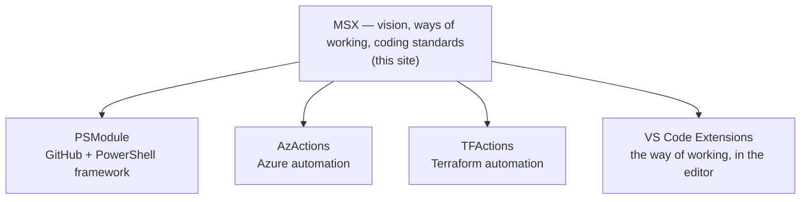

# Initiatives

Each **initiative** is a product that applies the vision through a framework, reusable actions, or an editor extension. Each product answers the same design question:

> What would this look like if it were *easy*, to move *fast*, in a *safe* way?

Initiatives inherit the vision, principles, ways of working, and coding standards from this site. Products can change or retire without changing these shared principles.

These pages describe the target roles and contracts of the initiatives. They do not establish which products or controls are deployed.

<!-- INDEX:START -->

| Page | Description |
| --- | --- |
| [PSModule](PSModule.md) | The GitHub + PowerShell framework — reusable modules and the actions that ship them. |
| [AzActions](AzActions.md) | Reusable building blocks for automating Azure on GitHub. |
| [TFActions](TFActions.md) | Reusable building blocks for automating Terraform and infrastructure as code. |
| [VS Code Extensions](VS-Code-Extensions.md) | Editor tooling that brings the MSX way of working into VS Code. |

<!-- INDEX:END -->

## How they fit together

Each initiative references these principles instead of restating them. Ideas begin in **[MSXOrg](https://github.com/MSXOrg)** as tooling, infrastructure, or experiments before they become separate initiatives.

## A living map

Each initiative links to the [Vision](../Vision/index.md) for its purpose and shared principles. Initiative pages describe the corresponding products and link to their canonical documentation.
