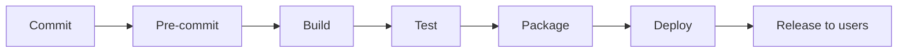

# Continuous Delivery and Release

Continuous integration, continuous delivery, continuous deployment, and continuous
release describe different automation boundaries. These boundaries determine when
human approval is required, what the pipeline can do automatically, and when a
change is complete.

[Continuous Practices](Continuous-Practices.md) describes the wider family of
always-on practices and the origin of each term.

## The distinction

Each practice extends the preceding practice. The automation boundary determines
how far a change proceeds without a human decision.

| Practice | What it means | Where it stops |
| --- | --- | --- |
| **Continuous integration** | Contributors merge every change into the mainline frequently and verify it there | A verified mainline. Nothing is packaged for release. |
| **Continuous delivery** | The pipeline packages every verified change and verifies that it is deployable. The mainline is releasable **at all times** | A releasable artifact. A human makes the business decision to deploy it. |
| **Continuous deployment** | The pipeline deploys a verified change automatically, without a manual gate | Deployed. Whether users see it is a separate question. |
| **Continuous release** | Users can see the change | Released to users. |

**Continuous delivery keeps an artifact ready for deployment; continuous
deployment automates deployment; continuous release makes the change available
to users.** Deployment does not by itself give users access.

Continuous integration covers `Commit → Test`. Continuous delivery extends to
`Package`, and stops. Continuous deployment extends to `Deploy` automatically.
Continuous release extends to `Release to users`. A feature flag or progressive
rollout can separate deployment from release. The release decision then controls
user exposure, not deployment.

A deployed change behind a disabled flag is not available to users.

## Shift left: pre-commit is CI running locally

A pre-commit hook runs the fast subset of CI checks on the contributor's machine.
It uses the same linters and formatters as the pipeline, before the commit exists.

Pre-commit applies these CI checks earlier. The pipeline remains authoritative.
A local run can be skipped and does not replace a required CI check.
Local checks give contributors feedback before a commit, rather than after a
pipeline run. See
[Pre-Commit](../Coding-Standards/Pre-Commit.md).

## Design decisions

Four design decisions apply these boundaries to a pipeline.

### D1 — Build once, decided per artifact type

The rule is *build once, promote the same artifact*. It applies across the
pull-request-to-main boundary only for artifacts that have an **external addressable
identity** independent of their version. If the version is embedded in the artifact,
promotion is impossible and the artifact MUST be rebuilt.

| Artifact | Across the PR → main boundary | Why |
| --- | --- | --- |
| Container image | **Promote** | Addressed by digest; a tag is metadata attached afterward |
| Stored infrastructure plan | **Promote** | The plan is the reviewed artifact; rebuilding it invalidates the review |
| Composite action referenced by tag | **Promote** | Identity is the git ref, not a built file |
| Compiled binary | **Rebuild** | Version is compiled in |
| Module manifest | **Rebuild** | Version is a field inside the manifest |
| Package manifest for a language registry | **Rebuild** | Version is a field inside the manifest |

**Promote artifacts with external identity; rebuild artifacts with an embedded
version.** Promotion preserves the artifact that reviewers verified.
A rebuild reproduces the artifact from verified source. Reproducibility gives
the guarantee for the rebuilt artifact.

### D2 — Version signals feed in, the decision is reviewed at the PR gate {#d2-version-signals-feed-in-the-label-decides-at-the-pr-gate}

This decision protocol applies only to actual Release Management routes,
including native producer pipelines. An unmanaged route has no release-decision
block, `release:*` labels, or missing-decision check; continuous delivery alone
does not opt it into a versioned release process.

Signals include the diff, test changes, commit messages, and an AI-assisted
analysis of the change. The release process MUST treat these signals as input. The
[resolved release decision](../Capabilities/release-management/design.md#version-computation)
comes from an explicit owned bump label or the valid effective `DefaultBump`, and
its suitability for the audience is reviewed at the pull-request gate.

A documented default records an existing policy decision.
Repository settings and supported caller inputs can override it; an
explicit owned bump label overrides the valid effective default. Invalid
supplied settings and conflicting owned labels fail rather than use a fallback.
The pull request records the effective level and its source, and review
confirms that the level fits the declared user/integrator impact. A missing
decision fails a required CI check and blocks merge; publication
does not discover the missing decision only after integration.

### D3 — Prerelease by default, stabilized on merge

A topic-branch build authorized for release MUST be published as a prerelease.
The pipeline creates the stable version on merge from the resolved release decision.

A prerelease version (`1.3.0-add-widgets.1`) has lower precedence than the stable
version with the same major, minor, and patch numbers. A consumer selects a
prerelease only through an explicit opt-in. Contributors and reviewers use the
published artifact to test throughout the pull request. They do not need to
build it manually.

The stable release contains the verified change without the prerelease suffix
in its version. D1 determines whether the pipeline promotes the artifact or
rebuilds it with the stable version.

### D4 — Recovery is roll-forward only

A published version MUST NOT be altered or replaced. Recovery from a bad release is a
new, higher version.

[SemVer](../Dictionary/index.md#semver) §3 requires immutable release contents.
A consumer can keep the artifact it already resolved as `2.4.1`. If its published
contents change, the same version identifies two different artifacts. Builds that
use those artifacts are not reproducible from the version alone.
Removing the version can break lockfiles that pin it.

The defective version remains published. Its release notes identify it as
defective, and the fix ships as `2.4.2`.

## References

- Jez Humble and David Farley, *Continuous Delivery*, Addison-Wesley, 2010 (ISBN 978-0321601919) — the source of the delivery definition and the build-once rule.
- Jez Humble, [Continuous Delivery vs Continuous Deployment](https://continuousdelivery.com/2010/08/continuous-delivery-vs-continuous-deployment/) — including the author's own remark that "a more accurate name might have been continuous release".
- Martin Fowler, [Continuous Integration](https://martinfowler.com/articles/continuousIntegration.html) and [Continuous Delivery](https://martinfowler.com/bliki/ContinuousDelivery.html).
- Dinah McNutt, [Release Engineering](https://sre.google/sre-book/release-engineering/), in *Site Reliability Engineering*, O'Reilly, 2016.
- [Semantic Versioning 2.0.0](https://semver.org/).
- Nicole Forsgren, Jez Humble and Gene Kim, *Accelerate*, IT Revolution, 2018.

## Where this connects

- [Continuous Practices](Continuous-Practices.md) — the wider Continuous X family and where each term comes from.
- [Release Management](../Capabilities/release-management/spec.md) — how the version decision and the prerelease flow are implemented.
- [Automation Labels](Automation-Labels.md) — why explicit release overrides use owned, namespaced labels.
- [Pre-Commit](../Coding-Standards/Pre-Commit.md) — the local half of the integration gate.
- [Branching and Merging](Branching-and-Merging.md) — the PR → main boundary the build-once decision is taken across.
