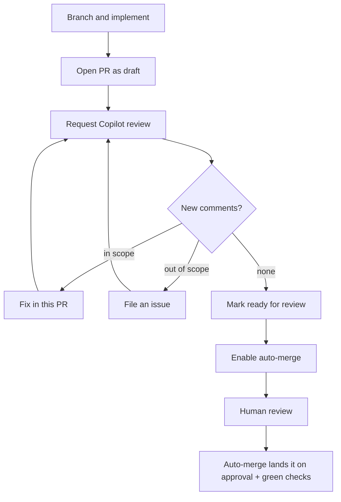

# Contribution Workflow

This workflow takes a change from a topic branch to a review-ready pull request.
The author completes Copilot review on a **draft** before requesting human review.

This procedure applies to a repository-delivery Task or Bug.
It follows [Issue Lifecycle](Issues/Process/Lifecycle.md), [PR Format](PR-Format.md),
[Branching and Merging](Branching-and-Merging.md), and [Review Etiquette](Review-Etiquette.md).
Epic and PBI aggregates remain in planning and coordination; they do not enter this flow.

## The flow



1. **Branch and implement.** Implement one ready, unblocked Task or Bug on a
   `<type>/<issue>-<description>` branch. Keep per-change implementation detail in
   that delivery issue and the pull request, not in the spec, design, or parent
   aggregate.
2. **Open the pull request as a draft.** Use a draft to run CI and iterate before
   requesting human review. Assign the pull request to
   its author and apply any repository-owned workflow labels.
3. **Run the Copilot review loop** (below) until Copilot reports a clean round —
   no changes requested and no new inline comments.
4. **Finalize and mark the pull request ready for review.** Re-read the complete
   diff and finalize the title and description per [PR Format](PR-Format.md).
   If the target route invokes Release Management, reconcile the conditional
   decision block and `release:*` labels with its effective configuration. If it
   does not, omit both. Then confirm the
   [Definition of Ready for Review](Definition-of-Ready-and-Done.md#definition-of-ready-for-review).
5. **Enable auto-merge** so the change merges automatically when human review
   approves it and all required checks pass. Human reviewers then assess the change.

## Why draft first

- **Copilot is the first pass.** The author addresses automated review feedback
  before requesting human review
  ([AI-First Development](Principles/AI-First-Development.md)).
- **People review a self-reviewed change.** Before requesting human review, the
  author completes the automated review loop and responds to its findings.
- **The draft is a safe workspace.** Authors can force-push, rewrite commits, and
  iterate while a pull request is a draft. Marking it ready requests human review.

## The Copilot review loop

In each round, request a review, wait for Copilot, and triage the feedback.
Repeat until the round is clean.
The `.github/scripts/Wait-CopilotReview.ps1` script **explicitly requests** a Copilot review.
It polls until Copilot submits a review, then reports whether Copilot left inline comments:

- exit `0` — a clean round: Copilot requested no changes and left **no new inline comments**;
- exit `2` — Copilot has feedback (a new inline comment or a changes-requested review);
- exit `1` — no review arrived before the timeout.

```powershell
# one round: request Copilot and wait for its verdict (-Verbose logs each step)
./.github/scripts/Wait-CopilotReview.ps1 -Repository MSXOrg/<repo> -PullRequest <n> -Verbose
```

**Always request the review explicitly — never assume a ruleset or other
automation will do it.** The script reads the timeline to determine whether
Copilot is already processing a request. It requests a review only if no request
is in progress. A review "requested automatically" on push or on marking ready
is not guaranteed to start.
Run a round after each push; the loop ends on a clean round (exit `0`).
Copilot reviews the complete diff again each round, so a genuine false positive can recur.
Do not change correct code to silence it.
Dismiss it with a reason and treat the loop as converged on substance.

## Triage: fix in scope, file an issue for the rest

For each piece of feedback, decide:

- **In scope** — it concerns the change under review. Address it in this pull
  request and push; the next round re-checks it.
- **Out of scope** — it identifies a pre-existing gap or an adjacent improvement.
  Route a follow-up through the [Issue Hierarchy](Issues/Types/Hierarchy.md) and
  reference it; do not grow the pull request to cover it.
- **Not actionable** — a false positive, or a matter of taste you disagree with.
  Reply with the reason and resolve the thread; a documented dismissal counts as
  handled ([Review Etiquette](Review-Etiquette.md)).

Separate follow-up issues keep the pull request within its delivery scope and
retain a record of each gap.

## Marking ready

Mark the pull request **ready for review** only after it meets every item in the
[Definition of Ready for Review](Definition-of-Ready-and-Done.md#definition-of-ready-for-review).
That gate is the single readiness checklist; no item remains open.
Readiness signals that automated review is completed and the change is ready for human review.
See [Review Etiquette](Review-Etiquette.md) for reviewer responsibilities.

A human contributor or an agent acting on their behalf may mark the pull request
ready after verifying that gate.
Readiness depends on the gate, not on who verifies it.

## Enable auto-merge

After the pull request is ready, enable auto-merge (squash).
Auto-merge waits for human approval and every required branch-protection condition before it merges the change.
These conditions include required checks, required approvals, and any other ruleset requirement.
There is no need to wait and manually select merge. See
[Branching and Merging](Branching-and-Merging.md#required-checks-and-auto-merge) for
the approval identity that satisfies the gate.

## Where this connects

- [Workflow](Workflow.md) — the spec-led loop this operates within.
- [Issue Lifecycle](Issues/Process/Lifecycle.md) — why only ready Task and Bug leaves enter this flow.
- [PR Format](PR-Format.md) — the pull request title, description, and
  route-conditional release metadata.
- [Definition of Ready and Done](Definition-of-Ready-and-Done.md#definition-of-ready-for-review) — the readiness gate this hands off at.
- [Branching and Merging](Branching-and-Merging.md) — the branch model a pull request builds on.
- [Review Etiquette](Review-Etiquette.md) — how human review proceeds once the pull request is ready.
