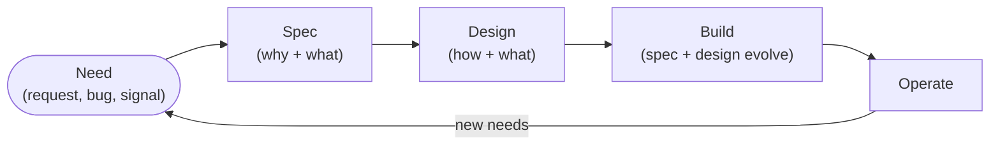

# Documentation Model

The documentation on this site serves **humans and agents**. Documentation is
a product, not a byproduct. Each capability has a **spec** and a **design**.
The two documents share a folder, remain concise, and change with the system.

## A spec and a design for every capability

Each capability the ecosystem builds is documented by two evergreen documents:

| Document | Owns | Answers | Written for |
| --- | --- | --- | --- |
| **Spec** | Requirements, expectations, needs | **Why** it exists and **what** it must do | Whoever decides *whether* and *what* to build |
| **Design** | Implementation approach | **How** and **what** is built to deliver the spec | Whoever *builds* and maintains it |

The **spec** defines the contract: behavior, guarantees, and success criteria
for users and agents. It does not specify the implementation. The **design**
describes how the system delivers that contract: mechanisms, components, and
configuration. Both documents change as intent or implementation changes.
Neither is a one-time plan.

Every capability uses the same spec-and-design model. A capability whose
**design composes other capabilities** is a *framework*. The term describes a
kind of capability, not a separate section or a different pair of documents.
It has the same spec and design as any other capability and lives beside them under
[Capabilities](../Capabilities/index.md).

Details of a *single change*, such as affected paths and local trade-offs, belong
at the delivery leaf's canonical
[issue planning altitude](Issues/Process/Planning.md) and in its pull request.
They do not belong in the spec or design.

## Capabilities live in folders

Related docs share a folder near the subject they describe. Each capability
folder contains its spec and design:

```text
Capabilities/
  release-management/
    index.md      # required navigation for this capability
    spec.md       # the why + what
    design.md     # the how + what is built
```

A reader finds the requirements and implementation approach in the same folder.
This follows [Documentation lives close to the thing
it documents](Principles/Engineering-Practices.md#documentation-lives-close-to-the-thing-it-documents)
for the spec and design. Where a design maps to a repository, the same two
documents live with the code.

Every capability folder requires an `index.md` for navigation. The spec and the
design are the two required **content artifacts**. Additional content uses the optional
[artifact tiers](Spec-Driven-Development.md#the-artifact-tiers), each of which has
a fixed home in the same folder:

```text
Capabilities/
  <capability>/
    index.md          # required navigation, not a content artifact
    spec.md           # the why + what                              (required content)
    features/         # per-feature spec addenda
      index.md
      <feature>.md
    design.md         # the how + what is built                     (required content)
    implementation.md # the concrete values and names
    guides/           # task-oriented walkthroughs
      index.md
      <task>.md
    references.md     # lookup tables
    decisions/        # one-way-door choices, immutable
      index.md
      <decision>.md
    research/         # point-in-time exploration
      index.md
      <exploration>.md
```

A tier that needs several pages uses a folder with an `index.md` and one page
per member. For example, `design.md` may become `design/`, and `references.md`
may become `references/`. The tier keeps the same meaning. A tier with no content
is not created. A folder appears only when it has content
([concise by default](#concise-by-default)).

## Why, what, how — a home for everything

| Concern | Owned by |
| --- | --- |
| **Why / what** a capability must do | the capability's **spec** |
| **How / what** is built to deliver it | the capability's **design** |
| **Which exact value or name** was chosen | the capability's **implementation** docs |
| **How to perform a task** with it | the capability's **guides** |
| **What the settings are** | the capability's **references** |
| **Which one-way-door choice** was made, and why | the capability's **decisions** |
| **What was explored** before deciding | the capability's **research** |
| **How the work is done** — process, principles, conventions | [Ways of Working](index.md) |
| **How code looks** — style applied to code | [Coding Standards](../Coding-Standards/index.md) |
| **Which consumer outcome this work accepts** | the Epic or PBI; see [consumer expectations](Issues/Process/Planning.md#consumer-expectations) |
| **How this one change is implemented** — paths, trade-offs | the Task or Bug delivery leaf and its PR; see [Issue Planning](Issues/Process/Planning.md) |
| **What a release changes, why, and how consumers align** | its source-bound release record, authored in the release-bound PR; see [PR Format](PR-Format.md) |

Implementation details change more often than requirements. The spec leaves
implementation choices to the design. The design leaves exact values to the
implementation docs. All tiers leave per-change detail to the issue and the PR.
This separation limits changes to the appropriate tier.

## It starts with a need

Every capability starts with a need. Work proceeds through a spec, a design,
code, and operation. Feedback from operation supplies further needs:

1. **Need** — a request, a bug, a review observation, a platform change.
2. **Spec** — agree the next version's requirements: why it matters and what it
   must do. This stage does not commit to delivery.
3. **Design** — after the commitment to deliver, describe the implementation approach.
4. **Build** — ready Task and Bug leaves implement the gap, evolving the design
   *and* the spec as development reveals more.
5. **Operate** — operation identifies further needs, which restart the cycle.



Both the spec and the design are **evolutionary**. Development changes the
understanding of the capability, so authors update both documents in place.
The first draft is not fixed. The gap between the intended contract and actual
system behavior defines the work.

Completion follows the shared [documentation and design evidence](Definition-of-Ready-and-Done.md#documentation-and-design-evidence) gate.
Update the owning artifact when the delivered result changes it.
Keep verification and justified no-change evidence in the delivery record.
Do not copy design or documentation into an aggregate issue.

## Evergreen and evolutionary

Specs and designs are **evergreen**: they describe the supported target-state
contract in the present tense. Authors update them in place as intent changes.
Git history records changes. The document states the current contract.

- **Declarative and present-tense.** Each statement describes the current contract.
- **Normative.** Requirements use MUST / SHOULD / MAY so obligations are
  unambiguous.
- **No status, deltas, phasing, or open questions.** Delivery plans belong in
  issues and PRs. Release-specific changes and adoption instructions belong in release records.
- **Measurable success criteria.** A spec states outcomes a reader can verify —
  *"a repository list returns every repository by default, with no silent
  truncation"* — never *"the sync is fast."*

Reviewers apply a short rubric before they accept a spec or design change.
Every requirement is testable. Success criteria are measurable and
implementation-free. The prose uses present tense and contains no delivery
status. Reviewers apply the rubric during review and in the PR
([4-eyes](Principles/AI-First-Development.md#4-eyes-or-n-eyes-principle)).
The rubric creates no separate artifact.

### Current product guidance and release history

Resource docs describe supported target-state behavior and usage. They include
READMEs, specs, designs, implementation docs, guides, and references.
Update them in place as that contract changes. Keep release-specific
old-to-new transitions, migration instructions, and change history in the
[release records](../Capabilities/release-management/design.md#release-notes),
not a parallel history file or migration-guide hierarchy.

A normative contract is not proof that its implementation or CI enforcement
exists. Delivery records contain that evidence and any remaining gap.

Release notes explain what changed, why, who is affected, compatibility, and
exact applicable adoption actions or an explicit no-action result. All applicable
records after the actual consumed baseline through the target supply the required
upgrade actions. PRs and diffs provide optional detail. General upgrade procedures
may explain how to use those records. They do not become another source of
release-specific instructions.

For an older target, a consumer reads that target's immutable source/documentation
snapshot and release records through [Consumer Upgrades](Consumer-Upgrades.md).
Current product guidance does not establish older-version behavior.

Decision records preserve choices, rationale, and supersession links. Research
preserves point-in-time findings. Evergreen resource docs do not replace these records.

## Concise by default

Concise documentation reduces the effort needed to find an answer, for humans
and agents.

- **Short and scannable.** Lead with the point. Prefer a table or a list to a
  paragraph. If a reader must scroll to find the rule, it is too long.
- **One fact, one place.** State a fact once and link to it. Never duplicate it
  ([DRY](Principles/Software-Design.md#dry-with-judgment)). Duplicate statements can disagree as the documentation changes.
- **Delete, don't stub.** Remove a section that does not apply rather than mark it
  "N/A". Empty sections make relevant content harder to find.
- **Close together.** Related docs share a folder near the code they describe.
  Short navigation paths reduce the effort needed to read the docs.

## Architecture and classification

The documentation tree is organized **by scope and subject**, then by the
artifact that answers the reader's question. A reader starts at the root
`index.md`, chooses the relevant topic, and follows that topic's index inward.
Related material stays together. Readers find the subject before they choose a
tutorial, guide, reference, or explanation.

The artifact tiers provide the second classification:

| Reader need | Owning artifact |
| --- | --- |
| Understand why a capability exists and what it guarantees | Spec |
| Understand how the capability is delivered | Design |
| Perform a task against a capability | Guide |
| Look up stable facts or values | Reference |
| Understand a one-way-door choice | Decision record |
| Revisit point-in-time findings | Research |

This classification covers the reader needs described by Diataxis without a
second taxonomy in paths or front matter. Each page has one home under its
subject and links to adjacent artifacts. Pages are not duplicated across quadrants.

## For humans and agents

Contributors read the index and follow its descriptions from section to page.
Agents follow the same path before they act. The docs are the single source, so
there is no separate "agent manual" that can disagree with them.
[Agentic Development](../Capabilities/agentic-development/index.md) explains how agent configuration
points at these pages rather than copying them.

## Where this connects

- [Workflow](Workflow.md) — the loop specs and designs revolve around.
- [Agentic Development](../Capabilities/agentic-development/index.md) — how humans and agents consume these docs.
- [README-Driven Context](Readme-Driven-Context.md) — why the README is the front door and the spec goes ahead of the code.
- [Coding Standards](../Coding-Standards/index.md) — how the code a design describes is written.
