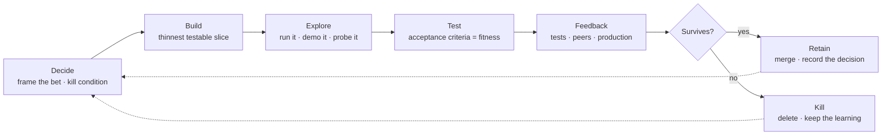
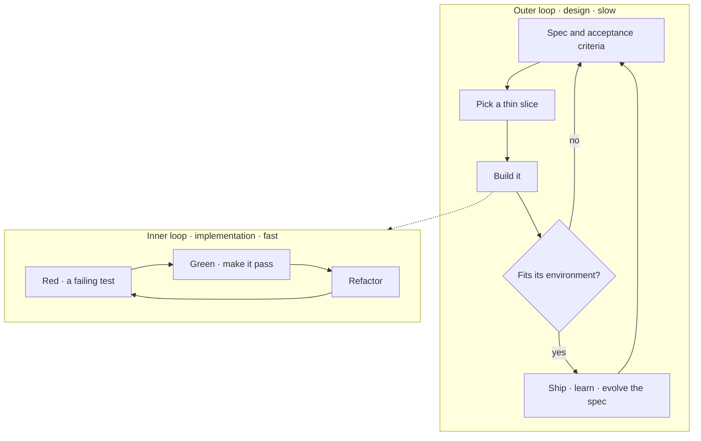

# Evolutionary Development

Software develops through small experiments with explicit acceptance criteria. Each change is a **bet**: a hypothesis tested against user needs, tests, load, and constraints.

The method uses Darwin's theory of evolution as an analogy: variation, selection, and survival of the fittest. Engineers direct the variation; real operating conditions supply the selection criteria. This differs from both blind natural selection and selection based only on an engineer's preference. The outcome is non-deterministic: intentions alone do not establish which design meets its criteria.

The method uses small experiments and frequent feedback to compare alternatives.

This standard connects three practices in one feedback cycle. [Spec-Driven Development](Spec-Driven-Development.md) records intent in a spec for the why and what, and a design for the how. Behavior-driven discovery expresses that intent as Given / When / Then acceptance criteria. Test-driven development implements the criteria and unit tests in small steps.

Context, criteria, and feedback guide the cycle, whether a person, an agent, or a group of agents drives it (see [How the loop is driven](#how-the-loop-is-driven)). It builds on [engineering practices](Principles/Engineering-Practices.md) (test-first where it pays, small batches, reversible decisions) and [AI-first development](Principles/AI-First-Development.md).

## Why evolve instead of plan

Intent is stated first. The plan evolves as evidence changes. Two habits guide the work:

- **Build shared understanding from concrete examples**, in rapid iterations, with documentation that is continuously checked against the system.
- **State the *why* and *what* first** so people and agents have the context they need, then refine as understanding grows.

Neither habit assumes the first design is correct. Both optimize the feedback cycle. A large initial design commits costly decisions when little is known. A small testable slice provides evidence while decisions remain reversible. Prefer the small bet.

## The loop

Each change moves through a small cycle of experimentation and selection. The cycle repeats until the design survives.

- **Decide.** State the bet as a hypothesis with an explicit kill condition. This is the result that would make the bet worth abandoning. Size the bet to its reversibility. Local, reversible decisions can be quick. Irreversible decisions require more care and a written record ([decision before change](Principles/AI-First-Development.md#decision-before-change), [engineering taste](Engineering-Taste.md)).
- **Build.** Build the smallest deliverable that can be assessed, such as a walking skeleton or throwaway spike. Use a thin vertical slice, not a layer ([engineering practices](Principles/Engineering-Practices.md)).
- **Explore.** Run the deliverable, demonstrate it, and test its boundaries. Exploration identifies surprises before further work depends on the design.
- **Test.** The [acceptance criteria](Spec-Driven-Development.md#acceptance-criteria) — Given / When / Then — are the coarse fitness function. Unit tests check the internals. The bet survives only if these tests pass. Retain the automated tests to prevent later changes from breaking verified behavior.
- **Feedback.** Collect evidence from tests, reviewers, and production. Include the [delivery-performance signals](DevOps-Reference.md#dora-four-key-metrics) and the one domain metric that the change is intended to affect.
- **Select.** Retain a design that passes its tests and promptly discard one that does not. A rejected slice produces evidence that updates the spec. Merge a retained slice through a decision point and record any one-way-door choice as an ADR beside the spec.

The loop turns until the design stops changing under feedback. Then the bet is settled (see [When a design survives](#when-a-design-survives)).

## How the loop is driven

Each cycle uses **context**, **acceptance criteria**, and **feedback**. A person, an agent, or a group of agents can drive it. End-to-end automation depends on context and criteria that are precise enough to guide a complete cycle.

The unit of work is a **well-scoped task** with a [context bundle](#context-first), acceptance criteria, and a fitness test. The test is the oracle, not the driver's confidence. The driver need not be trusted; the test does. Run **several bets in parallel** and retain the designs that meet their criteria instead of keeping every branch.

The decision gate does not change with the driver. Every change passes a [decision point](Principles/AI-First-Development.md#decision-before-change) before it reaches an environment. Automation performs the work without removing accountability.

## The two loops

The method distinguishes two feedback cycles: a slower design cycle and a faster implementation cycle.

- **The outer loop evolves the design.** It evaluates intent, acceptance criteria, and a small slice against real conditions. When feedback contradicts the intent, the spec changes first and the approach evolves through [spec-driven development](Spec-Driven-Development.md). This cycle settles the acceptance criteria and irreversible decisions. Small slices make incorrect assumptions easier to identify and revise.
- **The inner loop evolves the implementation.** It runs inside the **Build** stage through [test-driven development](Principles/Engineering-Practices.md#test-driven-development). Write a failing test. Make it pass. Refactor and repeat. Two test levels apply: **unit tests** for internals and **Given / When / Then acceptance tests** for discovered behavior. Many implementation cycles fit inside one design cycle, allowing rapid comparison of variations.

The **acceptance criteria** connect the two cycles. Written once as Given / When / Then, they define success for the design and the target for implementation. The same behavioral statement serves discovery, the spec, and the test, regardless of who drives the work.

## Signals: the shapes of intent

A cycle starts with a **signal**: evidence of a need, defect, operational problem, or risk. Each signal expresses intent in a different form. The same method applies to a bugfix, a performance safeguard, or a new capability.

- **Need.** A request for functionality or capability the product does not have yet — a user, a stakeholder, or a dependent system pulling it forward. Intent stated outright: *make it do this.*
- **Defect.** Proof that behavior and intent already disagree — a fault found in test or reported from production. An acceptance criterion that should hold does not, so the bet is to make it hold again.
- **Operational signal.** Logs, traces, metrics, and incidents — the SRE evidence that the system is straining under real load. A rising error rate or a slow path is intent the users never had to type; the environment is speaking.
- **Preventive analysis.** A proactive read that a design will not survive where it is heading — a performance cliff, a stability risk, a scaling limit seen before it bites. Intent inferred from the trajectory, not the pain.

Each signal enters the same cycle with context, acceptance criteria, and feedback. Each passes the same [decision point](Principles/AI-First-Development.md#decision-before-change). A defect and a preventive fix use the same evaluation method as a new capability.

## Discovery: finding and framing the bet

Discovery starts from a need, defect, operational symptom, or risk rather than a solution. Discovery, formulation, and automation produce an evidence-based [specification](Spec-Driven-Development.md) and its acceptance criteria.

- **Discovery.** Before starting work, hold a short, structured conversation about concrete examples. Map the story to **rules** (acceptance criteria), **examples** for each rule, and **questions** to resolve or defer. Time-box the conversation. If the examples do not fit, split the story. The conversation must cover three viewpoints: the problem, implementation, and edge cases. People or agents can supply these perspectives.
- **Formulation.** Turn the agreed examples into Given / When / Then, in the shared language of the domain. Use the same domain vocabulary in the criteria and the implementation.
- **Automation.** Connect each example to the system as a failing test, then build until it passes. The examples are living documentation. The build fails when code does not satisfy the behavior they describe.

Discovery creates candidate behaviors before implementation. Mark unknowns as `[NEEDS CLARIFICATION]` rather than guessing. A guess has no evidence to support acceptance.

## Context first

Each cycle requires correct, complete context. The **context bundle** contains:

- The [spec](Spec-Driven-Development.md) (why, what, acceptance criteria) and its design (how), or the marked unknowns where they do not exist yet.
- The constraints, non-goals, and dependencies that bound the solution.
- Pointers to the code, standards, and prior decisions that already apply — read in layers, local context before central standards ([Agentic Development](../Capabilities/agentic-development/index.md)).

This makes [context-first development](Principles/AI-First-Development.md#context-first-development) operational. Create context in specs, issues, and ADRs before the cycle. Incomplete context can lead to incorrect results and wasted work. Update a standard or instruction when evidence shows it is wrong or reveals a better approach (see [The instructions evolve too](#the-instructions-evolve-too)).

## The instructions evolve too

Durable, reusable instructions follow the same engineering practices as code. This includes standards, guides, stored prompts, skills, and agent files. Source control, testing and verification, pull requests, review, and acceptance apply through the [Contribution Workflow](Contribution-Workflow.md). One-off chat requests are outside these source-control and pull-request requirements.

> [!IMPORTANT]
> Self-directed update is a standing directive, not an optional courtesy. A person or agent that learns something or finds an incorrect instruction starts a proposed correction immediately. Do not leave the correction for someone else. Starting a correction does not bypass verification, review, or acceptance. The next cycle uses the accepted correction. A cycle that cannot improve its instructions cannot evolve.

These instructions provide context for each cycle (see [How the loop is driven](#how-the-loop-is-driven)). A weak instruction can misdirect every reader. Correct instructions when they are wrong and refine them when evidence identifies a better approach. This maintenance is part of the work. It applies [self-improving agents](Principles/AI-First-Development.md#self-improving-agents) to the instructions themselves.

When a cycle exposes an incorrect instruction or a better way of working, propose the correction as its own small change. Its pull request must be reviewed, approved, and merged through the same [decision point](Principles/AI-First-Development.md#decision-before-change). Only then does the correction become accepted guidance. Relevant signals include:

- An agent needs the same clarification twice, or a `[NEEDS CLARIFICATION]` marker keeps recurring.
- A review comment teaches a rule that is not written down yet.
- An instruction contradicts how the work is actually done, or points at something that has moved.
- A turn goes wrong in a way a clearer instruction would have prevented.
- A cycle finds a better prompt, sequence, or rule that should be reused.

A standard is defined once and referenced by its consumers ([Agentic Development](../Capabilities/agentic-development/index.md)). Correct a missing or incorrect rule in its canonical document before adding or updating instructions that depend on it. Prompts, skills, and agent instructions link to that document instead of copying the rule. The same verification that keeps a spec aligned with intent also keeps instructions accurate as understanding grows.

## Working a v1

A first version starts with limited evidence. Keep it small and add complexity only as test results and feedback justify it.

- **Minimal viable spec.** Write only the intent and acceptance criteria needed to test the first bet. Mark unresolved points as open questions instead of inventing answers. Expand the spec as evidence becomes available.
- **Walking skeleton.** Build the thinnest end-to-end slice with real inputs and outputs before expanding any single part. This tests the complete path while decisions remain reversible.
- **Explore a set, then converge.** For a consequential decision, compare two or three approaches through inexpensive parallel spikes. Retain the approach that meets its criteria and discard the others. Compare alternatives before committing to one design.
- **Promote or kill.** A spike is disposable by default. Promote it only if it passes its fitness test. Otherwise, delete it and use the findings to update the spec. A spike does not become production code without this evaluation.
- **Evolve the spec first.** When feedback contradicts the spec, the spec changes before the code — it is the source of truth, written in the present tense as the [intended state](Principles/Engineering-Practices.md#evergreen-documentation).

## Bind to the practice, not the tool

The toolchain can change without changing the method. Given / When / Then examples state behavior independently of the runner. Depend on documented intent, concrete examples, living documentation verified in CI, and the feedback cycle. Tools act as replaceable adapters to this method ([extensible by default](Principles/Software-Design.md#extensible-by-default)).

## When a design survives

A bet becomes the baseline when:

- its acceptance criteria pass and keep passing as guard-rails,
- the domain signal moved the way the spec predicted,
- no clarification markers remain, and
- it is observable and quiet under normal load.

At that point, the change meets the [Definition of Done](Definition-of-Ready-and-Done.md#definition-of-done) and the slice is retained. A further change starts another bet. If requirements or operating conditions change, reconsider the design and deprecate or delete it when it no longer fits ([engineering practices](Principles/Engineering-Practices.md)).
