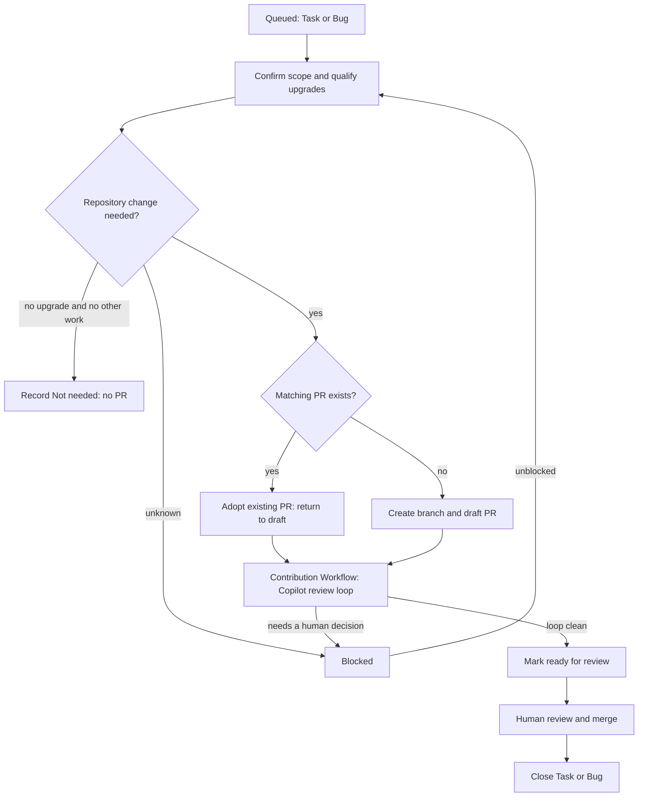

# Fleet Orchestration

A *campaign* applies one change across many repositories.
Each repository that needs a change has its own Task or Bug delivery leaf,
branch, pull request, and review loop. The campaign coordinates progress and
makes it visible.

Each repository follows the ordinary [Contribution Workflow](Contribution-Workflow.md):
a draft, the Copilot review loop, then human review. Its branch follows
[Git Worktrees](Git-Worktrees.md). Fleet orchestration repeats that loop across
repositories and tracks the full set. It does not replace the per-repository workflow.

For an upstream upgrade, each delivery follows
[Consumer Upgrades](Consumer-Upgrades.md). A campaign can share a fixed target.
It cannot assume that consumers share the same actual baseline, release range,
template differences, or required actions.

The defining rule is that **the state of a campaign lives on GitHub**, in its
issues and pull requests. A local file or database is never the source of truth.
Any person or tool can inspect and manage a campaign with the GitHub CLI alone.

## When to use it

- Use it when the *same* change must apply to *many* repositories.
  Examples include a shared workflow or dependency update, a fleet-wide
  convention, or a mechanical migration.
- Use it when consumers of an organization- or initiative-owned Action or
  reusable workflow must move to a new breaking major. Compatible releases stay
  on the existing controlled major tag; advancing that alias alone needs no
  reference-change campaign. Explicit pinned upgrades still follow the common
  consumer procedure.
- For a change in a single repository, there is no campaign — just follow the
  [Contribution Workflow](Contribution-Workflow.md).

## The campaign

A campaign applies one change across a set of repositories. Each repository
starts with one Task or Bug delivery leaf. It gets a branch and PR only when
qualification establishes a required repository change.

A campaign has a short, stable **slug**, such as `process-psmodule-v6`, that
prefixes every delivery issue. A campaign pull request uses its native
Development link to the prefixed issue for that identity. Its title states the
reader-facing result. A closing keyword creates that link only when the pull
request targets the repository's default branch.

An **existing open pull request can be adopted** when its scope matches the
campaign slice. Link it to exactly one correctly typed Task or Bug.
Create the delivery issue first if it is missing.
Add the remaining change to the existing branch instead of opening a duplicate.
Reuse avoids competing pull requests without bypassing the canonical
[Issue Hierarchy](Issues/Types/Hierarchy.md) or [PR Format](PR-Format.md).

## State lives on GitHub

There is no orchestration database. Every fact needed to resume, hand off, or
audit a campaign is stored on GitHub, in two layers.

### Built-in properties come first

If GitHub models a fact, its native property *is* the state.
Do not copy it into another state-bearing field. Duplicate state can disagree.

| Fact | GitHub property |
| --- | --- |
| Delivery exists | its Task or Bug issue |
| Who holds it | `assignees` |
| Work in progress | pull request is a **draft** |
| Ready for a human | pull request is **not** a draft |
| CI health | the status-check rollup |
| Review outcome | `reviewDecision` and unresolved review threads |
| Mergeability | `mergeable` / merge-state status |
| Integration complete | pull request **merged** |
| No upgrade needed | Unneeded leaf **closed as not planned**, with the [no-upgrade outcome](Consumer-Upgrades.md#stage-2-fix-the-target-and-release-path) evidenced |
| Delivery complete | The [completion-owning issue](Definition-of-Ready-and-Done.md#post-merge-completion-ownership) **closed as completed** with its gate evidenced |
| Issue ↔ PR link | the native Development link; a supported default-branch closing reference or an explicit manual link |

The draft flag records review readiness. The merged state records integration.
Neither merge nor automatic issue closure proves required publication,
deployment, or producer/template completion. Linked delivery evidence records
those obligations separately.

### Campaign identity lives on the delivery issue

Campaign membership is carried in a stable square-bracket prefix on every
delivery issue title, for example `[shared-workflow-alignment]`. Each campaign
pull request is natively linked to exactly one of those issues.
The Development relationship associates it with the campaign without copying
internal metadata into its title. Labels remain reserved for mutable workflow state.

### Link and close for the actual target

For a default-branch target, use the scoped closing reference from [PR
Format](PR-Format.md). For a non-default target, link the pull request
and delivery issue through GitHub's **Development** sidebar. Verify the native
link. Description closing keywords are ignored on those targets. See
[GitHub's linking rules](https://docs.github.com/en/issues/tracking-your-work-with-issues/using-issues/linking-a-pull-request-to-an-issue).

A non-default merge does not close the issue automatically. Keep the delivery
issue open until its recorded [Definition of Done](Definition-of-Ready-and-Done.md#repository-delivery-leaf) holds.
This includes any required default-branch integration or publication.
The recorded completion owner verifies the evidence. The owner then closes the
issue explicitly or links the completed delivery to a qualifying default-branch integration PR.
Do not close it merely to make the dashboard show Done.

### Process labels fill the gap

The model uses one label namespace for state that GitHub has no property for.
The labels use project-management terms, not tool- or agent-specific terms.
People, agents, and separate automation systems interpret them the same way.

| Label | Purpose |
| --- | --- |
| `stage:queued` | Delivery issue exists; no pull request has started. |
| `stage:in-progress` | Actively being changed; the assignee owns it. |
| `stage:blocked` | Needs a human decision or a manual, off-platform action before it can proceed. |

The campaign prefix is mandatory on every delivery issue. Each campaign pull
request has a native link to one prefixed issue. Its reader-facing title follows [PR
Format](PR-Format.md) without the prefix. At most one `stage:*` label applies at a time.
Remove the current `stage:*` label before adding its replacement.

A `stage:*` label may be removed when the pull request supplies the equivalent
native signal. A ready pull request needs no `stage` label.
Keep `stage:blocked` when a human must act, because GitHub has no equivalent
native property. The slug inside the issue prefix is lowercase and hyphenated.

## Effective status

A campaign view derives one **effective status** per repository delivery from
the native properties and process labels above. The first matching rule wins.

| # | Effective status | Condition |
| --- | --- | --- |
| 1 | Merged | pull request is merged |
| 2 | Not needed | unneeded delivery leaf is closed as not planned with an evidenced no-upgrade outcome and no remaining PR work |
| 3 | Blocked | `stage:blocked`, or the merge state is dirty/conflicting |
| 4 | Changes requested | review decision is changes-requested, or unresolved review threads remain |
| 5 | Ready for review | pull request is not a draft and not merged |
| 6 | CI failing | checks are failing on a draft |
| 7 | In review | draft with at least one review and CI not failing |
| 8 | In progress | draft with no review yet, or `stage:in-progress` |
| 9 | Queued | Task or Bug open, no pull request yet |

Terminal and attention states (merged, not needed, blocked, changes requested,
ready) rank above transient progress states. An explicit ready or blocked signal
takes precedence over checks in progress.

## The flow

Each repository follows the same lifecycle. GitHub actions define each transition,
so the recorded properties determine the resulting state.



1. **Queue and qualify the work.** Create one Task or Bug delivery issue per repository, with
   the campaign prefix in the title and `stage:queued`. Route it through the
   [Issue Hierarchy](Issues/Types/Hierarchy.md) and follow its canonical type
   page. For an upgrade, establish the actual baseline and fixed target through
   [Consumer Upgrades](Consumer-Upgrades.md#stage-1-establish-the-actual-baseline)
   before creating or adopting a branch or PR. A proven no-upgrade outcome with no
   other local work becomes *Not needed*. Unknown provenance becomes *Blocked*.
   For an existing PR, qualify against the actual pre-upgrade consumer state, not
   its proposed references. Preserve any remaining local acceptance work.
2. **For a needed change, branch and open a draft.** Create a worktree and branch
   ([Git Worktrees](Git-Worktrees.md)). Open a **draft** pull request natively
   linked to exactly that prefixed delivery issue, per [PR Format](PR-Format.md)
   and the target-specific linking rules above.
   The Development link carries campaign membership, so the pull request title
   states only its reader-facing result. Clear the issue's `stage:queued`.
   Then set `stage:in-progress` so the repository delivery never has two stages at once.
   If an open pull request covers part of the change, adopt it instead of opening another.
   Add the remaining change to its branch. Return it to **draft** while work is in progress.
   Clear `stage:*` from its delivery issue. Then give the pull request `stage:in-progress`.
   If the native link to the prefixed Task or Bug is missing, add and verify it before continuing.
3. **Apply the change and run the loop.** Make the change.
   Follow the [Contribution Workflow](Contribution-Workflow.md) and its Copilot
   review loop, as for any single-repository change. The
   [Implement](Workflow-Stages/Implement.md) and [Review](Workflow-Stages/Review.md)
   workflow stages apply unchanged. For an upgrade, continue with the per-consumer
   release-range ledger and immutable template comparison in
   [Consumer Upgrades](Consumer-Upgrades.md), including no-action ranges.
4. **Flag blockers, don't stall the fleet.** If a delivery leaf needs a human
   decision or off-platform action, remove its current `stage:*` label.
   Set `stage:blocked` and add a note.
   Continue to the next repository.
5. **Mark ready only when the loop is clean.** When Copilot has no more feedback
   and CI is green, mark the PR ready per the
   [Definition of Ready and Done](Definition-of-Ready-and-Done.md). The draft
   flag changes and the repository delivery becomes *Ready for review*.
6. **Human review and merge land it.** Merge integrates the change. A qualifying
   default-branch closing reference closes its Task or Bug automatically;
   non-default delivery follows the recorded completion and closure rules above.
   The campaign's goal is to make every pull request *Ready*.
   [Branching and Merging](Branching-and-Merging.md) governs how it merges.

An evidenced [no-upgrade outcome](Consumer-Upgrades.md#stage-2-fix-the-target-and-release-path)
ends without manufacturing a branch or PR. Apply the common procedure's issue
disposition; the fleet reports *Not needed*, not a delivered upgrade.

## Breaking-major migrations

Organization- or initiative-owned Actions and reusable workflows may publish
compatible patch and minor releases through a controlled floating major tag.
That central rollout stops at the major boundary. A breaking release publishes a
new major tag and leaves the previous major line in place.
Consumers move only when a deliberate campaign changes each `uses:` reference.

The campaign records the compatibility decision explicitly. Its delivery leaves
use [Consumer Upgrades](Consumer-Upgrades.md) to establish the source that
actually ran. They compose every applicable crossed release and verify required
integration changes before merge. The current
destination of a floating major tag is not evidence of a consumer's prior
baseline. The producer's controlled release automation MUST NOT repoint an
existing major tag to perform this migration.

## What a rollout surfaces

A rollout can reveal pre-existing problems across the fleet.
Examples include tool rules that detect existing debt, upstream bugs exposed by
the selected version, and invalid files. Classify each blocker by its cause
instead of adding unrelated work to the campaign:

- **Caused by the change** — fix it in the campaign pull request; it is part of
  the work.
- **Pre-existing debt** — leave it to its owning effort and keep the pull request
  scoped to the change. Unrelated fixes expand the campaign scope in one
  repository and delay the fleet.
- **Upstream or shared tooling** — file an issue against the shared component, set
  `stage:blocked` with a note linking it, and move on.
  One shared fix unblocks every affected repository.

The same change can produce repeated review feedback across pull requests.
Decide the response once: a fix or an evidence-based reply for a false positive.
Apply it consistently, except where repository-specific differences affect the finding.

Discovery can also surface a repository where the change applies differently, or
not at all. Adapt that delivery leaf — its scope, change, and pull request
description — to what the repository actually needs.
Do not force an identical diff.

## The dashboard

A **dashboard** is a deterministic projection of GitHub state, not a separate
state store. A dashboard script enumerates delivery issues by title prefix
(`[<slug>]` across the owners). It follows native Development links, reads
built-in properties, computes effective status, and renders a page.
The page can refresh at intervals as GitHub changes. Deleting the projection
loses no campaign state because GitHub is the source of truth.

Read linked pull requests with full pagination and include closed or merged
ones. `closedByPullRequestsReferences` retrieves closing associations, not every
manual Development link. Also read the issue's native `ConnectedEvent` and
`DisconnectedEvent` timeline entries, including both source and subject.
Fold those entries in returned timeline order for each issue–PR pair.
A connection adds the manual association, and a disconnection removes it.
Keep only pairs with the queried issue's node ID at one endpoint and a PR at the other.
Use PR node IDs, not display numbers, as the identity. Combine
the current manual associations with closing references, deduplicate by PR
identity, then read each PR's live state. Ordinary prose cross-references do not
replace a verified Development association.

Verify explicit links for non-default targets.
Do not reconstruct them from ignored keywords or assume the closing-reference query is complete.
Report a missing or unreadable link on an in-progress delivery as a discovery gap,
not an empty or completed delivery.

Typical columns: effective status, repository, delivery issue and pull request, draft/ready,
CI, review decision and open-thread count, assignee, the latest progress note,
and last-updated. Rows sort by status, then repository name, to group items that
need attention. *Ready for review* appears when a pull request is marked ready.
*Merged* appears when it merges.

A local `JSON` snapshot may be written as a cache for other tools, and a static
`HTML` page rendered for viewing. Both are disposable projections regenerated
from GitHub. A database would create a second source of truth that can disagree.

## Progress notes

To describe the work, post a comment on the delivery issue.
When the pipeline stage changes, update the `stage:*` label.
The dashboard shows the latest comment as the delivery's note.
Status updates use scripted label-and-comment writes.
The only human or agent judgment is *which* status applies.

## Driving it by hand or from another system

Because all state is on GitHub and the workflow labels are generic:

- **A person** can run a campaign from the GitHub UI.
  Filter by the campaign prefix in delivery issue titles.
  Follow each issue's linked pull request and read its draft and merge state.
  The UI supports `stage:*` label changes and merges.
- **An automated system** can enumerate the issues with one query.
  It can follow their native pull request references and resume any delivery.
  Examples include a scheduled workflow, another agent framework, or a teammate's tooling.
  The state is portable and self-describing.

If an automated run stops, GitHub retains the recorded campaign state.
Each pull request retains its native properties.
Another person or system can resume from those records instead of needing a private store.

## Command reference

These GitHub CLI commands support manual and scripted operation.
Labels and comments use the issues API, which serves issues and pull requests.

```powershell
# enumerate a campaign's delivery issues across an owner
gh search issues 'in:title "[<slug>]"' --owner <owner> `
  --json number,repository,title,url,state

# read closing associations, including closed/merged PRs, with full pagination
$query = @'
query($owner: String!, $repo: String!, $number: Int!, $endCursor: String) {
  repository(owner: $owner, name: $repo) {
    issue(number: $number) {
      closedByPullRequestsReferences(first: 100, after: $endCursor, includeClosedPrs: true) {
        nodes { id number url state }
        pageInfo { hasNextPage endCursor }
      }
    }
  }
}
'@
gh api graphql --paginate -f query="$query" -f owner='<owner>' -f repo='<repo>' -F number='<n>'

# read manual Development associations separately; fold connect/disconnect pairs
$developmentQuery = @'
fragment DevelopmentSubject on ReferencedSubject {
  __typename
  ... on Issue { id url }
  ... on PullRequest { id number url }
}
query($owner: String!, $repo: String!, $number: Int!, $endCursor: String) {
  repository(owner: $owner, name: $repo) {
    issue(number: $number) {
      id
      timelineItems(
        first: 100
        after: $endCursor
        itemTypes: [CONNECTED_EVENT, DISCONNECTED_EVENT]
      ) {
        nodes {
          __typename
          ... on ConnectedEvent {
            createdAt
            source { ...DevelopmentSubject }
            subject { ...DevelopmentSubject }
          }
          ... on DisconnectedEvent {
            createdAt
            source { ...DevelopmentSubject }
            subject { ...DevelopmentSubject }
          }
        }
        pageInfo { hasNextPage endCursor }
      }
    }
  }
}
'@
gh api graphql --paginate -f query="$developmentQuery" -f owner='<owner>' -f repo='<repo>' -F number='<n>'

# read one pull request's authoritative state
gh pr view <n> --repo <owner>/<repo> --json `
  isDraft,state,reviewDecision,statusCheckRollup,mergeStateStatus,assignees

# set the pipeline stage (remove the others first) and add a progress note
gh api -X DELETE repos/<owner>/<repo>/issues/<n>/labels/stage:in-progress
gh api -X POST   repos/<owner>/<repo>/issues/<n>/labels -f "labels[]=stage:blocked"
gh api -X POST   repos/<owner>/<repo>/issues/<n>/comments -f body="<note>"

# ready for review — the native "ready for a human" signal
gh pr ready <n> --repo <owner>/<repo>
```

## Worked example: A shared workflow upgrade

A shared workflow campaign resolves one fixed producer release and identifies
its consumers. Producer-owned guidance identifies its release and template
sources; source-bound release records own version-specific migration actions.
[Consumer Upgrades](Consumer-Upgrades.md) supplies the per-repository procedure
without inventing or duplicating those instructions.

- **Slug:** `shared-workflow-alignment`.
- **Discover the fleet:** find consumers of the reusable workflow with a code
  search for its `uses:` reference. Queue a Task delivery issue in each.
- **Per repository:** establish its actual immutable baseline and fixed target,
  then read every applicable source-bound release record.
  Compose the required actions and intermediate operations.
  Reconcile immutable template compatibility while preserving intentional local differences.
  Verify the result with existing checks. Missing required evidence blocks that delivery.
  Do not copy another repository's edits or assume every consumer needs a test migration.
- **Track it:** every delivery issue starts with `[shared-workflow-alignment]`;
  each pull request uses a reader-facing title and a verified native issue link.
  Default-branch closing keywords and explicit non-default linking follow the
  target-specific rules above. The dashboard retains both live and merged PRs.
  Linked evidence distinguishes integration from delivery completion.

## What this is not

- **Not a database.** Any `JSON` or `HTML` is a disposable projection of GitHub.
- **Not agent-specific.** The model stays fully operable by people and non-agent
  tools; nothing in it depends on a particular assistant.
- **Not a shared label store.** Labels are per-repository; the delivery-issue
  prefix plus the native Development link is the shared contract in each
  participating repository.
