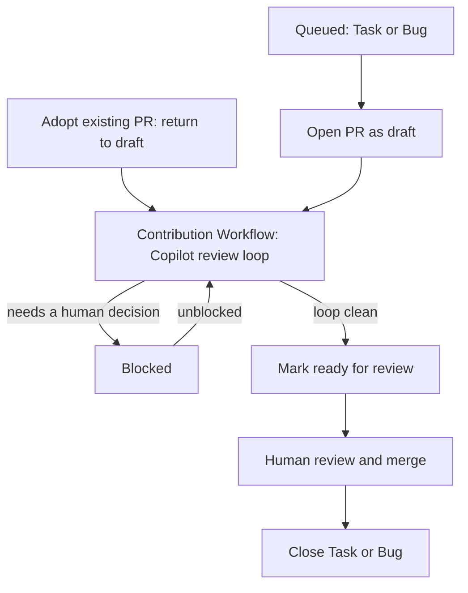

# Fleet Orchestration

How a single change is applied across many repositories at once — a *campaign*.
Each repository gets its own Task or Bug delivery leaf, branch, pull request,
and review loop; the campaign is the coordination layer that keeps them moving
and visible.

This is the multi-repository "how". Inside each repository the change follows the
ordinary [Contribution Workflow](Contribution-Workflow.md) — draft first, the
Copilot review loop, then people — on a branch created per
[Git Worktrees](Git-Worktrees.md). Fleet orchestration adds nothing to that loop;
it repeats it across a fleet and tracks the whole set.

The defining rule: **the state of a campaign lives on GitHub**, on the issues and
pull requests themselves — never in a local file or database. Anyone, or any
tool, can read and drive a campaign with the GitHub CLI alone.

## When to use it

- Use it when the *same* change must land in *many* repositories: a shared
  workflow or dependency bump rolled out to every consumer, a convention applied
  fleet-wide, or a mechanical migration.
- Use it when consumers of an organization- or initiative-owned Action or
  reusable workflow must move to a new breaking major. Compatible releases stay
  on the existing controlled major tag and do not need a consumer campaign.
- For a change in a single repository, there is no campaign — just follow the
  [Contribution Workflow](Contribution-Workflow.md).

## The campaign

A campaign is one change rolled out across a set of repositories. Each
repository's slice is one Task or Bug delivery leaf and its pull request. A
campaign has a short, stable **slug** (for example `process-psmodule-v6`) that
prefixes every delivery issue. A campaign pull request carries that identity
through its native Development link to the prefixed issue, leaving the pull
request title free for its reader-facing result. A closing keyword creates that
link only when the pull request targets the repository's default branch.

An **existing open pull request can be adopted** when its scope matches the
campaign slice. Link it to exactly one correctly typed Task or Bug,
creating that delivery issue first when it is missing, then add the remaining
change to the existing branch instead of opening a duplicate. Reusing what is
already open avoids competing pull requests without bypassing the canonical
[Issue Hierarchy](Issues/Types/Hierarchy.md) or [PR Format](PR-Format.md).

## State lives on GitHub

There is no orchestration database. Every fact needed to resume, hand off, or
audit a campaign is stored on GitHub, in two layers.

### Built-in properties come first

If GitHub already models a fact, that property *is* the state — it is never
copied into another state-bearing field, because duplicated state drifts.

| Fact | GitHub property |
| --- | --- |
| Delivery exists | its Task or Bug issue |
| Who holds it | `assignees` |
| Work in progress | pull request is a **draft** |
| Ready for a human | pull request is **not** a draft |
| CI health | the status-check rollup |
| Review outcome | `reviewDecision` and unresolved review threads |
| Mergeability | `mergeable` / merge-state status |
| Done | pull request **merged**; Task or Bug **closed** |
| Issue ↔ PR link | the native Development link; a supported default-branch closing reference or an explicit manual link |

"Ready for review" is the draft flag flipping off; "Merged" is the pull request's
merge state. Delivery completion also requires the Task or Bug to close after
its recorded Done gate. These are native signals, not copied stage fields.

### Campaign identity lives on the delivery issue

Campaign membership is carried in a stable square-bracket prefix on every
delivery issue title, for example `[shared-workflow-alignment]`. Each campaign
pull request is natively linked to exactly one of those issues, so the
Development relationship joins it to the campaign without copying internal metadata into
its title. Labels stay reserved for mutable workflow state.

### Link and close for the actual target

For a default-branch target, use the scoped closing reference from [PR
Format](PR-Format.md). For a non-default target, explicitly link the pull request
and delivery issue through GitHub's **Development** sidebar and verify the native
link; description closing keywords are ignored on those targets. See
[GitHub's linking rules](https://docs.github.com/en/issues/tracking-your-work-with-issues/using-issues/linking-a-pull-request-to-an-issue).

A non-default merge does not close the issue automatically. Keep the delivery
issue open until its recorded [Definition of Done](Definition-of-Ready-and-Done.md#repository-delivery-leaf)
holds, including any required default-branch integration or publication. The
recorded completion owner then verifies the evidence and closes it explicitly,
or links the completed delivery to a qualifying default-branch integration PR.
Never close it merely to make the dashboard show Done.

### Process labels fill the gap

Only one label namespace is added, for state GitHub has no property for. The
labels are ordinary project-management words — not tool- or agent-specific — so a person
with the web UI, an agent, or a separate automation system all read them the
same way.

| Label | Purpose |
| --- | --- |
| `stage:queued` | Delivery issue exists; no pull request has started. |
| `stage:in-progress` | Actively being changed; the assignee owns it. |
| `stage:blocked` | Needs a human decision or a manual, off-platform action before it can proceed. |

Rules: the campaign prefix is mandatory on every delivery issue; each campaign
pull request is natively linked to one prefixed issue and uses the reader-facing title from [PR
Format](PR-Format.md) without the prefix; at most one `stage:*` label applies at
a time; and `stage:*` may be dropped once a pull request carries the signal
itself (a ready pull request needs no `stage` label, but `stage:blocked` stays
explicit because "a human must act" has no built-in equivalent). The slug inside
the issue prefix is lowercase and hyphenated.

## Effective status

A campaign view shows one **effective status** per repository delivery, derived purely from
the two layers above — no guessing. The first matching rule wins.

| # | Effective status | Condition |
| --- | --- | --- |
| 1 | Merged | pull request is merged |
| 2 | Blocked | `stage:blocked`, or the merge state is dirty/conflicting |
| 3 | Changes requested | review decision is changes-requested, or unresolved review threads remain |
| 4 | Ready for review | pull request is not a draft and not merged |
| 5 | CI failing | checks are failing on a draft |
| 6 | In review | draft with at least one review and CI not failing |
| 7 | In progress | draft with no review yet, or `stage:in-progress` |
| 8 | Queued | Task or Bug open, no pull request yet |

Terminal and attention states (merged, blocked, changes requested, ready) rank
above transient progress states, because an explicit act — marking ready, or
flagging blocked — is a stronger signal than in-flight checks.

## The flow

Each repository moves through the same lifecycle. Every transition is a concrete
GitHub action, so the resulting state is always re-derivable.



1. **Queue the work.** Create one Task or Bug delivery issue per repository, with
   the campaign prefix in the title and `stage:queued`. Route it through the
   [Issue Hierarchy](Issues/Types/Hierarchy.md) and follow its canonical type
   page. The whole fleet starts as *Queued*.
2. **Branch and open a draft.** Create a worktree and branch
   ([Git Worktrees](Git-Worktrees.md)), then open a **draft** pull request natively
   linked to exactly that prefixed delivery issue, per [PR Format](PR-Format.md)
   and the target-specific linking rules above.
   The Development link carries campaign membership, so the pull request title
   states only its reader-facing result. Move the stage to `stage:in-progress`,
   clearing the issue's `stage:queued` so the repository delivery never carries
   two stages at once. If the repository already has an open pull request that
   covers part of the change, adopt it instead of opening a new one: add the
   remaining change to its branch, return it to **draft** while work is in
   progress, and give it `stage:in-progress` (clearing `stage:*` from its delivery
   issue). Verify its native link to the prefixed Task or Bug before continuing
   if the adopted pull request did not already have one.
3. **Apply the change and run the loop.** Make the change and take the pull
   request through the [Contribution Workflow](Contribution-Workflow.md) —
   the Copilot review loop — exactly as any single-repository change. The
   [Implement](Workflow-Stages/Implement.md) and [Review](Workflow-Stages/Review.md)
   workflow stages apply unchanged.
4. **Flag blockers, don't stall the fleet.** If a delivery leaf needs a human decision or
   an off-platform action, set `stage:blocked` with a note and move on to the next
   repository.
5. **Mark ready only when the loop is clean.** When Copilot has no more feedback
   and CI is green, mark the pull request ready for review per the
   [Definition of Ready and Done](Definition-of-Ready-and-Done.md). The draft
   flag flips and the repository delivery becomes *Ready for review*.
6. **Human review and merge land it.** Merging lands the change. A qualifying
   default-branch closing reference closes its Task or Bug automatically;
   non-default delivery follows the recorded completion and closure rules above.
   The campaign's job is to get every pull request to *Ready*;
   [Branching and Merging](Branching-and-Merging.md) governs how it merges.

## Breaking-major migrations

Organization- or initiative-owned Actions and reusable workflows may publish
compatible patch and minor releases through a controlled floating major tag.
That central rollout stops at the major boundary. A breaking release publishes a
new major tag and leaves the previous major line in place; consumers do not move
until a deliberate campaign changes each `uses:` reference.

The campaign records the compatibility decision rather than hiding it in release
automation. Its delivery leaves update the major reference, apply any required
input, output, permission, or behavior migration, and verify the consumer before
merge. The producer's controlled release automation MUST NOT repoint an existing
major tag to perform this migration.

## What a rollout surfaces

Applying one change across a whole fleet is also a fleet-wide audit. The same
edit that lands cleanly in most repositories will expose latent problems in a
few: a newer tool version starts enforcing a rule that flags pre-existing debt,
an upstream bug appears only under the new version, or a file was never quite
valid to begin with. Expect this, and triage each blocker by its cause instead
of absorbing it:

- **Caused by the change** — fix it in the campaign pull request; it is part of
  the work.
- **Pre-existing debt** — leave it to its owning effort and keep the pull request
  scoped to the change. Widening one repository's pull request to clean up
  unrelated problems breaks the "same change everywhere" property and stalls the
  fleet.
- **Upstream or shared tooling** — file an issue against the shared component, set
  `stage:blocked` with a note linking it, and move on. One fix there
  unblocks every repository hitting the same wall.

Because the change is identical everywhere, the review loop tends to raise the
*same* point on many pull requests. Decide the response once — a fix, or an
evidence-based reply when it is a false positive — and apply it consistently: a
concern that is invalid on one repository is usually invalid on the rest,
barring a repository where the change genuinely differs.

Discovery can also surface a repository where the change applies differently, or
not at all. Adapt that delivery leaf — its scope, change, and pull request
description — to what the repository actually needs, rather than forcing an
identical diff.

## The dashboard

A campaign is watched through a **dashboard** — a deterministic projection of
GitHub state, not a store of its own. A script enumerates the campaign's
delivery issues by title prefix (`[<slug>]` across the owners), follows each
native Development link to its pull request, reads the built-in properties,
computes the effective status, and renders a page. It can regenerate on an
interval so the view refreshes as GitHub changes; deleting it loses nothing,
because GitHub is the source of truth.

Read linked pull requests with full pagination and include closed or merged
ones. `closedByPullRequestsReferences` retrieves closing associations, not every
manual Development link. Also read the issue's native `ConnectedEvent` and
`DisconnectedEvent` timeline entries, including both source and subject.
Fold those entries in returned timeline order for each issue–PR pair: a
connection adds the manual association and a disconnection removes it. Keep only
pairs with the queried issue's node ID at one endpoint and a PR at the other;
use PR node IDs, not display numbers, as the identity. Combine
the current manual associations with closing references, deduplicate by PR
identity, then read each PR's live state. Ordinary prose cross-references do not
replace a verified Development association.

Verify explicit links for non-default targets rather than reconstructing
them from ignored keywords or assuming the closing-reference query is complete.
A missing or unreadable link on an in-progress
delivery is a discovery gap to report, not an empty or completed delivery.

Typical columns: effective status, repository, delivery issue and pull request, draft/ready,
CI, review decision and open-thread count, assignee, the latest progress note,
and last-updated. Rows sort by status then repository name, so the items needing
attention group together. *Ready for review* appears the instant a pull request
is marked ready; *Merged* the instant it merges.

A local `JSON` snapshot may be written as a cache for other tools, and a static
`HTML` page rendered for viewing — both are disposable projections, regenerated
from GitHub at will. A database is deliberately avoided: it would become a second
source of truth that drifts.

## Progress notes

To record *what* is being done — narration, not a state change — post a comment
on the delivery issue and, when the pipeline stage changes, move the `stage:*` label.
The dashboard surfaces the latest comment as the delivery's note. Setting a status is
a deterministic label-and-comment write, so it is scripted; the judgement of
*which* status applies is the only human or agent decision.

## Driving it by hand or from another system

Because all state is on GitHub and the workflow labels are generic:

- **A person** can run a whole campaign from the GitHub UI — filter by
  the campaign prefix in delivery issue titles, follow each issue's linked pull
  request, read its draft and merge state, move `stage:*` labels, and merge.
- **An automated system** — a scheduled workflow, a different agent framework, or
  a teammate's tooling — can enumerate the issues with one query, follow their
  native pull request references, and pick up any delivery. The state is
  portable and self-describing.

If an automated run stops midway, nothing is lost: the board is complete, every
in-flight pull request shows its true state, and anyone can finish the job. This
resilience is the reason state is kept on GitHub rather than in a private store.

## Command reference

The mechanics are ordinary GitHub CLI calls, so they are easy to script or run by
hand. Labels and comments use the issues API, which serves issues and pull
requests alike.

```powershell
# enumerate a campaign's delivery issues across an owner
gh search issues 'in:title "[<slug>]"' --owner <owner> `
  --json number,repository,title,url,state

# read closing associations, including closed/merged PRs, with full pagination
$query = @'
query($owner: String!, $repo: String!, $number: Int!, $endCursor: String) {
  repository(owner: $owner, name: $repo) {
    issue(number: $number) {
      closedByPullRequestsReferences(first: 100, after: $endCursor, includeClosedPrs: true) {
        nodes { id number url state }
        pageInfo { hasNextPage endCursor }
      }
    }
  }
}
'@
gh api graphql --paginate -f query="$query" -f owner='<owner>' -f repo='<repo>' -F number='<n>'

# read manual Development associations separately; fold connect/disconnect pairs
$developmentQuery = @'
fragment DevelopmentSubject on ReferencedSubject {
  __typename
  ... on Issue { id url }
  ... on PullRequest { id number url }
}
query($owner: String!, $repo: String!, $number: Int!, $endCursor: String) {
  repository(owner: $owner, name: $repo) {
    issue(number: $number) {
      id
      timelineItems(
        first: 100
        after: $endCursor
        itemTypes: [CONNECTED_EVENT, DISCONNECTED_EVENT]
      ) {
        nodes {
          __typename
          ... on ConnectedEvent {
            createdAt
            source { ...DevelopmentSubject }
            subject { ...DevelopmentSubject }
          }
          ... on DisconnectedEvent {
            createdAt
            source { ...DevelopmentSubject }
            subject { ...DevelopmentSubject }
          }
        }
        pageInfo { hasNextPage endCursor }
      }
    }
  }
}
'@
gh api graphql --paginate -f query="$developmentQuery" -f owner='<owner>' -f repo='<repo>' -F number='<n>'

# read one pull request's authoritative state
gh pr view <n> --repo <owner>/<repo> --json `
  isDraft,state,reviewDecision,statusCheckRollup,mergeStateStatus,assignees

# set the pipeline stage (remove the others first) and add a progress note
gh api -X POST   repos/<owner>/<repo>/issues/<n>/labels -f "labels[]=stage:blocked"
gh api -X DELETE repos/<owner>/<repo>/issues/<n>/labels/stage:in-progress
gh api -X POST   repos/<owner>/<repo>/issues/<n>/comments -f body="<note>"

# ready for review — the native "ready for a human" signal
gh pr ready <n> --repo <owner>/<repo>
```

## Worked example: A shared workflow upgrade

A campaign aligns consumers with one fixed producer release. Its release records
own the version-specific migration actions; this general procedure does not
invent or duplicate them.

- **Slug:** `shared-workflow-alignment`.
- **Discover the fleet:** find consumers of the reusable workflow with a code
  search for its `uses:` reference, then queue a Task delivery issue in each.
- **Per repository:** establish its actual consumed baseline and fixed target,
  read every applicable source-bound release record, compose the required
  actions and intermediate operations, preserve local intent, and verify the
  result with its existing checks. A required instruction missing from the
  records blocks that delivery.
- **Track it:** every delivery issue starts with `[shared-workflow-alignment]`;
  each pull request uses a reader-facing title and a verified native issue link.
  Default-branch closing keywords and explicit non-default linking follow the
  target-specific rules above. The dashboard retains both live and merged PRs.

## What this is not

- **Not a database.** Any `JSON` or `HTML` is a disposable projection of GitHub.
- **Not agent-specific.** The model stays fully operable by people and non-agent
  tools; nothing in it depends on a particular assistant.
- **Not a shared label store.** Labels are per-repository; the delivery-issue
  prefix plus the native Development link is the shared contract in each
  participating repository.
