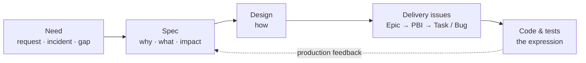

# Spec-Driven Development

The specification is the source of truth for *why* a change matters and *what* it must do. Design, delivery issues, code, and tests serve that specification. When intent changes, the spec changes first.

This standard defines the **specification**, its **design**, and the supporting artifact tiers. It states their content, level of detail, and role in the delivery lifecycle. It builds on the [evergreen documentation](Principles/Engineering-Practices.md#evergreen-documentation) principle for authoring and the [engineering practices](Principles/Engineering-Practices.md) for planning, delivery, and measurement.

## The model

Each artifact has a defined level of detail and a location near the subject it governs. Git versions each artifact. Higher layers remain stable while lower layers change as understanding improves.

| Layer | Answers | Altitude | Lives in | Changes when |
|---|---|---|---|---|
| **Need** | Is this worth doing? | one line | the request or issue | — |
| **Spec** | Why, what, for whom, and what "done" means | implementation-agnostic | the capability folder, in the owning repo | intent changes |
| **Design** | How it is built | technical, still readable | beside its spec (`design.md`) | the approach changes |
| **Delivery issues** | In what tracked outcomes and deliverables | progressively actionable | Epic and PBI aggregates, then Task and Bug leaves | the delivery plan changes |
| **Code & tests** | The working expression | concrete | the codebase | continuously |



The spec is the durable artifact. Code expresses it in a particular language and framework. When they disagree, the spec states the intent and the code shows the outcome.

## The artifact tiers

The spec and the design are the two required **content artifacts**; each
capability folder also has its required `index.md` navigation page. A
capability MAY carry five more content artifacts when its content needs
a different level of detail or a different reader. Each tier answers one question
for one audience. It links to other tiers instead of restating them.

| Artifact | Answers | Reader | Required |
|---|---|---|---|
| **[Specification](#what-a-specification-is)** | Why it exists, what must be true | whoever decides *whether* and *what* | MUST |
| **[Design](#what-a-design-is)** | How it is built, logically | whoever builds and maintains it | MUST |
| **[Implementation docs](#what-implementation-docs-are)** | The concrete settings, names, and mappings | whoever operates or changes the concrete detail | MAY |
| **[Guides](#what-a-guide-is)** | How to carry out a task against the shipped capability | whoever uses it | MAY |
| **[References](#what-a-reference-is)** | Stable facts, for fast lookup | whoever needs one value | MAY |
| **[Decision records](#what-a-decision-record-is)** | Which choice was made, and why that one | whoever inherits or questions the choice | MAY |
| **[Research](#what-research-is)** | What was explored and what was found | whoever revisits a decision | MAY |

A tier is added when existing content needs a separate artifact to keep the higher tier concise. A capability with no concrete detail needs no implementation doc. A capability that nobody operates manually needs no guide. Empty tiers are not created in advance: **[delete, don't stub](Documentation-Model.md#concise-by-default)**.

## What a specification is

A specification describes the intended state of one capability or feature and why that state matters. A competent reader needs no local context to understand it. Its requirements remain valid when code refactoring changes the implementation. Write it in the concise, present-tense, definitive style of [evergreen documentation](Principles/Engineering-Practices.md#evergreen-documentation).

A spec **contains**:

- **The problem** — who is affected, what is wrong or missing for them, and why it matters. Stated as an enduring condition, not a moment in time.
- **Outcomes and impact** — the result for users or operators and its expected effect on delivery (see [Impact](#impact)).
- **Users and jobs** — who uses the capability and the task it supports.
- **Scope** — what is included, and an explicit list of what is out of scope.
- **Non-goals** — outcomes the capability deliberately does not pursue. These clarify intent, while out of scope limits this change.
- **Requirements** — functional behavior and non-functional qualities, each with its own behavioral scenarios (see [Requirements](#requirements)).
- **Acceptance criteria** — the cross-cutting observable behavior that spans more than one requirement (see [Acceptance criteria](#acceptance-criteria)).
- **Constraints, assumptions, and dependencies** — the boundaries it respects and the work, access, or decisions it waits on.

A spec **excludes** the following design and delivery details:

- Technology, frameworks, and libraries.
- Architecture, components, and diagrams.
- API shapes, schemas, and data models.
- Algorithms and pseudo-code.
- The task breakdown and rollout sequence.
- Links to the code that fulfills it, because implementations change.

A specification is **output-focused**: it states behavior and observable outcomes, not the technology or product that produces them. Two implementations that satisfy the same spec are interchangeable under that spec.

The **spec/design altitude test** separates behavior from implementation. A sentence belongs in the design if different technology changes it without changing the required behavior. Keep implementation detail in the design and delivery scope at the appropriate [issue planning altitude](Issues/Process/Planning.md).

### Conformance to principles

A spec **conforms to** the [Principles](Principles/index.md) and never restates them. The [principles' own contract](Principles/index.md#principles-do-not-link-down) sets the reference direction: specs link up, and principles do not link down.

A rule that applies to every capability belongs in a principle or standard. The spec links to that source instead of creating a copy that can disagree with it. When a spec needs a narrow exception, it names the exception and links to the standard that permits it.

### Core and feature addenda

A capability that grows features MAY be composed of a **core specification** and **feature-addendum pages**. The core states the invariants, qualities, and requirements shared by every feature. Each feature page is self-contained, extends the core, and states only what is specific to that feature.

- A requirement that more than one feature depends on is stated **once in the core** and referenced by link. It is never duplicated onto a feature page.
- Requirement numbering is **per page**: the core starts at `FR1`, and every feature page also starts at `FR1`. Identity is the page plus the anchor: `[FR1](features/scheduling.md#fr1)`. Moving a feature out of the core does not renumber requirements.
- Feature pages live in a `features/` folder beside the core spec, with their own `index.md`.

The core remains stable as features are added. A single-feature capability keeps one `spec.md` and adds `features/` only when a second feature exists.

## Specify the minimum

A spec fixes only the requirements needed for correctness and verification. It leaves all other choices to the design and the people who build it. Extra requirements force decisions before they are needed and require updates when implementation details change. Fix what must be agreed and leave the other choices open.

This applies [Lean Software Development](Principles/Planning-and-Delivery.md#lean-software-development) and YAGNI to intent. Fewer fixed requirements keep the spec stable and leave implementation choices open. The altitude test above applies this principle.

## Requirements

Requirements are testable statements of what must be true, not how it is built. Use the [BCP 14](https://www.rfc-editor.org/info/bcp14) keywords in uppercase for their normative meaning: **MUST**, **MUST NOT**, **SHOULD**, **SHOULD NOT**, **MAY**, and the rest of the set. [RFC 2119](https://www.rfc-editor.org/rfc/rfc2119) and [RFC 8174](https://www.rfc-editor.org/rfc/rfc8174) define that meaning.

**Functional** requirements describe observable capability behavior. **Non-functional** requirements state quality attributes: performance, security, reliability, availability, compliance, observability, and cost. Each states a measurable condition with a numeric threshold. For platform and infrastructure work, these qualities often determine the value of the change. Latency, redaction, retention, and blast radius determine whether the capability is fit to operate.

Give each requirement its own heading with a stable, explicit anchor. Use `### FR1 — <statement> {#fr1}` for functional requirements and `### NFR1 — <statement> {#nfr1}` for non-functional requirements. The anchor contains only the identifier, so changes to heading text do not break references.

Identifiers are **append-only**. Assign the next unused number. Never renumber or reuse an identifier. A removed requirement disappears, and git preserves its history.

Numbering is scoped **per page**. The core spec and each of its [feature addenda](#core-and-feature-addenda) start at `FR1` and `NFR1`. Identity is the page plus the anchor. Use `[FR1](#fr1)` on the same page and `[FR1](spec.md#fr1)` across pages. A feature reference has the form `features/<feature-name>.md#fr2`. Requirements moved to a separate feature page retain their numbers because identity includes the page.

### Behavioral scenarios

Each requirement has a `#### Behavioral scenarios` subsection immediately beneath it. The subsection contains one or two Given / When / Then scenarios for that requirement. These are its acceptance criteria, stated once beside the requirement.

````markdown
### FR1 — A request MUST succeed while any healthy upstream provider remains {#fr1}

#### Behavioral scenarios

```gherkin
Scenario: The primary provider is unavailable
  Given the primary upstream provider is returning errors
  When a client sends a request
  Then the request succeeds through a healthy provider
  And the response records which provider served it
```
````

Requirement-local scenarios MUST NOT be repeated in the consolidated [acceptance criteria](#acceptance-criteria). One scenario, one home.

## Acceptance criteria

The consolidated **Acceptance criteria** section contains only **cross-cutting** scenarios that span more than one requirement. Each is labeled `AC1`, `AC2`, and so on, and names the requirements it verifies.

```gherkin
# AC1 — Verifies: [FR1](#fr1), [NFR2](#nfr2)
Scenario: Failover stays within the latency budget
  Given the primary upstream provider is returning errors
  When a client sends a request
  Then the request succeeds through a healthy provider
  And the total response time stays within the stated budget
```

Requirement-local scenarios and cross-cutting criteria define the contract between the spec and the working system. They form the basis for the [Definition of Done](Definition-of-Ready-and-Done.md#definition-of-done) and the acceptance tests that verify the change. Every requirement has at least one scenario. A spec with no cross-cutting behavior has no `Acceptance criteria` section.

Criteria describe effect, not mechanism: "requests succeed when the primary provider is down", not "a failover handler is added". The design owns the mechanism, which can change without changes to the criteria.

## Impact

Every spec states its intended delivery impact. The value is explicit before work starts and measurable after delivery:

- **DORA direction** — the expected effect on lead time for changes, deployment frequency, change-failure rate, and time to restore service (the [DORA four](DevOps-Reference.md#dora-four-key-metrics)). State the direction and reasoning, not a false-precision number.
- **A domain signal** — one concrete, measurable metric this change affects for users of the capability.

Estimate before work starts to establish its value. Measure after delivery to learn from the result. Missed metric targets, incidents, and additional constraints inform the next spec update.

## What a design is

The design is the specification's companion. It answers *how* and can change with the implementation while the spec remains stable.

A design **contains** the approach and its rationale, including alternatives and reasons for rejection. It describes architecture, components, data, and contracts that other components depend on. It covers security boundaries and threats for new surfaces. It states the testing strategy and the rollout and operability plan.

A design is **logical**: it names the approach and technology and remains readable as a whole. It excludes exact values.

The **design/implementation altitude test** separates the approach from concrete detail. A sentence belongs in [implementation docs](#what-implementation-docs-are) if exact settings, counts, or names change it without changing the technology or approach. Otherwise, it belongs in the design. This keeps the design readable without discarding concrete detail.

One-way-door decisions taken in the design are recorded as [decision records](#what-a-decision-record-is) beside the spec, not left implicit in the design prose.

A design MAY be a single `design.md` or a `design/` folder when it grows past one page. The name stays singular either way.

## What implementation docs are

An implementation doc contains the concrete details that a design deliberately excludes. These include exact configuration values, element and resource names, taxonomies, requirement mappings, and the scripts that apply them. Each mapping connects a requirement to the element that satisfies it, field by field.

Implementation docs keep exact settings separate from the logical design. When a design lists settings, those settings move to implementation docs. The design keeps the explanation and a link.

An implementation doc is **optional**. A capability whose design carries no concrete detail does not have one.

## What a guide is

A guide gives an operational procedure for a shipped capability. A person or agent follows its steps to complete a task. The specification states why and what, while the design describes how the capability is built.

A guide states the steps and nothing else. It links to the spec for context and to a [reference](#what-a-reference-is) for values. It never restates either. Guides live in a `guides/` folder beside the spec, with one task per page. Each page is named for its task.

## What a reference is

A reference provides stable facts for lookup: schemas, endpoints, parameters, labels, identifiers, and supported values. It uses uniform, neutral tables instead of narrative, steps, or rationale.

Each fact lives on exactly **one** reference page, and other artifacts link to it. A reference is not owned by a single design because several designs may depend on the same fact.

## What a decision record is

A decision record captures one choice that constrains later work. It records the context, options considered, choice made, and accepted consequences. The author writes it once, when the decision is made.

A decision record is required for a **one-way door**: a choice whose later reversal costs materially more than a different original choice. Public contracts, data formats that outlive a release, identity and permission models, and choices that consumers depend on all qualify. A readily reversible choice belongs in the design instead.

A decision record is **immutable**. A later decision has a separate record that supersedes it. The superseded record links to its replacement without overwriting the original rationale.

Decision records live in a `decisions/` folder beside the spec of the scope they constrain. Each page names one choice and follows [Decision Before Change](Principles/AI-First-Development.md#decision-before-change).

The design states what is built. The decision record preserves the rejected alternatives and the reasons for the choice.

## What research is

Research records the exploration and findings that informed a capability's decisions. It states what was investigated, tried, and found.

Research is the one artifact that is **not evergreen**. It is a point-in-time record written in the past tense. It does not change when later conditions change. A later exploration has a separate page. Git records its dates.

Research **informs but never governs**. When a finding becomes a commitment, it moves into the spec or design. The research links to the decision it informed. Research lives in a `research/` folder owned by the scope it informs. Only cross-cutting exploration lives centrally.

## From need to shipped change

The method is requirements-first. Work starts from a need, not a solution.

1. **A need surfaces.** A stakeholder request, an incident, or a platform gap — or the team authors one when it sees the opportunity.
2. **Draft the spec.** Capture the why, outcome, and requirements collaboratively. Agents draft, research context, and identify ambiguity and gaps. Humans supply intent and make decisions ([AI-first development](Principles/AI-First-Development.md)). Mark unknowns instead of guessing (see [Authoring conventions](#authoring-conventions)).
3. **Review the spec as a pull request.** Version and review the spec like any change, following [PR Format](PR-Format.md) and [Review Etiquette](Review-Etiquette.md). Review resolves intent before delivery.
4. **Accept the spec.** Resolve clarification markers, confirm testable requirements and acceptance criteria, and review the intent before committing to delivery.
5. **Design and decompose.** Write the design. Use canonical [Issue Planning](Issues/Process/Planning.md) and [Issue Hierarchy](Issues/Types/Hierarchy.md) guidance to create Epic or PBI aggregates and ready Task or Bug delivery leaves.
6. **Build against the spec.** Pull only a ready Task or Bug into Build. Implement in thin vertical slices. Finish through its applicable [Definition of Done](Definition-of-Ready-and-Done.md#definition-of-done) ([engineering practices](Principles/Engineering-Practices.md)). The coding standards and Definition of Done govern [test-driven development](Principles/Engineering-Practices.md#test-driven-development). Individual specs do not restate that implementation practice.
7. **Feed reality back.** Use metrics and incidents to update the spec and repeat the cycle.

## Where specs and designs live

A specification and its design share a folder named for their capability, with the required `index.md` navigation page. This is the [capability folder](Documentation-Model.md#capabilities-live-in-folders) pattern.

A component owns the capability. By default, a component is a repository ([Repository Segmentation](Repository-Segmentation.md)). The spec lives beside the code it governs ([docs live close to the code](../Coding-Standards/Documentation.md#the-hierarchy-of-documentation)):

- **A component's own capabilities** → that repository's `docs/`.
- **Cross-cutting capabilities** that span components → the central documentation hub.

Separating the spec from the design keeps requirements stable across refactors while the design changes with the code. The [Documentation Model](Documentation-Model.md#capabilities-live-in-folders) defines the artifact tiers and folder layout.

## Authoring conventions

- **Write intended state.** Use present-tense, definitive prose and state each fact once, as with all [evergreen documentation](Principles/Engineering-Practices.md#evergreen-documentation). Keep task lists, status, and history in issues and PRs, not the spec.
- **Write impersonally.** Use third person throughout. A spec does not address the reader, name a person, or refer to "we" or "the team". It states facts that remain valid when roles or teams change.
- **State enduring problems, not timing.** Avoid "why now", "currently", "recently", and similar time-bound framing. State the condition that makes the capability valuable. Record a durable time bound, such as a published deprecation or contractual date, as a constraint.
- **Let git carry the record.** Keep created and updated dates, revision numbers, authorship, and changelogs in repository history, not document fields. Commits and pull requests that reference the spec preserve that history without duplicate records.
- **Ownership is by location, not a byline.** The team that owns the code owns its spec ([docs live close to the code](../Coding-Standards/Documentation.md#the-hierarchy-of-documentation)). Accountability lives in `CODEOWNERS`, not a per-document owner field that can become incorrect.
- **Conform, do not restate.** A spec links up to the principle or standard it obeys and never copies it. The direction is one-way by [design](Principles/index.md#principles-do-not-link-down): principles do not link down to specs.
- **Mark unknowns, do not guess.** If the need is unclear, add an explicit `[NEEDS CLARIFICATION: the specific question]` marker. Do not invent an answer. Resolve and remove all markers before acceptance.
- **Self-review against a checklist.** Before review, confirm that no clarification markers remain. Confirm that every requirement is testable and has at least one scenario. Confirm that success criteria are measurable.
- **Keep it navigable.** The spec is readable in one sitting. Move detailed content to the design, an implementation doc, or a reference.
- **Reference, do not restate.** Link to the canonical standard or guide instead of copying it. Keep one source of truth.
- **Links, not bare URLs.** Every external reference is a Markdown link, scoped the same way as in the [Issue Format](Issues/Process/Format.md).

## Templates

[Spec-Driven Development Templates](Spec-Driven-Development-Templates.md) provides a skeleton for each artifact tier. These include specification, feature addendum, design, implementation doc, guide, reference, research, and decision record. Copy the template for the artifact. Delete a heading only when it does not apply.

## Influences

The method adapts established practices to evergreen documentation near the code and AI-first development:

- **[Spec Kit](https://github.com/github/spec-kit)** — the spec → design → tasks split, the *what and why, not how* discipline, clarification markers, and checklists as tests for the specification.
- **Amazon's Working Backwards (PR/FAQ)** — start from the outcome and the customer, not the feature list.
- **Google design docs and Architecture Decision Records** — the design layer: context, non-goals, alternatives, and recorded decisions.
- **Behavior-Driven Development** — acceptance criteria as Given / When / Then.
- **[DORA](DevOps-Reference.md#dora-four-key-metrics)** — framing impact in delivery-performance terms.
