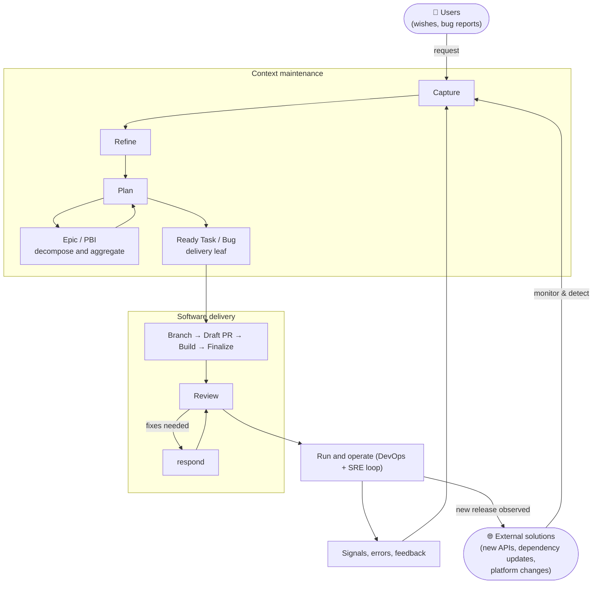

# Workflow

The workflow connects issue capture, planning, delivery, review, and operation.

## The big picture

Two activities run continuously:

1. **Context** — maintain accurate, evergreen issues, decisions, READMEs, and documentation.
2. **Software** — deliver code, tests, and releases.

Software operation produces signals for context maintenance. Refined context defines the next software change.

## Find the current stage

Follow the documentation indexes: [Home](../index.md) → [Ways of Working](index.md) → Workflow. Infer the current stage from the work and its artifacts, then use the [stage procedure index](Workflow-Stages/index.md) or the direct links below. A stage is a part of this workflow, not a separate agent, skill, or instruction set.

| Current work or prompt | Enter | Continue until |
| --- | --- | --- |
| A request, signal, or issue needs to be captured, routed, refined, or planned. Prompts such as `Make this issue <description>` route here. | [Define](Workflow-Stages/Define.md) | The issue meets the readiness gate for its altitude. |
| A ready Task or Bug needs implementation, or a pull request needs author-side changes. Prompts such as `Implement <issue>` or `Fix <issue>` route here. | [Implement](Workflow-Stages/Implement.md) | The pull request meets the ready-for-review gate. |
| A pull request needs an independent assessment. Prompts such as `Review this PR <link>` route here. | [Review](Workflow-Stages/Review.md) | The change is approved or actionable feedback returns it to Implement. |
| The requested assessment is explicitly security-focused. Prompts such as `Security review <scope>` route here. | [Security Review](Workflow-Stages/Security-Review.md) | Findings are reported through the agreed channel and the review returns to its caller. |
| The workflow pages or repository pointers themselves need to change. | [Maintain Workflow Guidance](Workflow-Stages/Maintain-Guidance.md) | The canonical docs and thin pointers agree. |

Keywords are shortcuts, not a second routing system. When a prompt is ambiguous, use the current issue, pull request, branch, and completed work to identify the stage. When work crosses a stage boundary, follow the handoff and load the next procedure rather than carrying separate process instructions through the whole task.

## Phases

### Capture

A desire for change enters the system. It can come from anywhere:

- A user request or feature idea.
- A bug report or error signal.
- An observation during a review.
- A dependency update or platform change.

Record the request promptly in a GitHub issue. The issue gives contributors and agents a persistent record to refine.
Initial capture prioritizes a recorded need over complete detail. State the current condition, the problem or opportunity, and the desired outcome.

See the [Issue Lifecycle](Issues/Process/Lifecycle.md) for how the issue evolves during Capture.

### Refine

Clarify the recorded need and expected result:

- What is the actual problem, distinct from its symptoms and proposed solutions?
- Who is affected and how?
- What does "done" look like from
  1. the user's perspective?
  2. the maintainer's perspective?
- Are there constraints, dependencies, or prior decisions that matter?

This may involve questions in issue comments, interactive discussion, or research.
The goal is **shared understanding** — everyone (humans and agents) agrees on what the real problem is and what the outcome should be.

### Plan

Turn the refined understanding into actionable work:

- **Gap analysis** — compare the affected capability's [evergreen specification](Documentation-Model.md#evergreen-and-evolutionary) with the current implementation. Plan work for the differences.
- **Route and define** — assign the native type and use its [planning altitude](Issues/Process/Planning.md): consumer expectations and scenarios in Epics/PBIs, technical decisions and test-first plans in Task/Bug leaves.
- **Decompose aggregates** — use native sub-issues for Epic and PBI children, and native dependency edges only where execution is genuinely gated.
- **Prepare delivery leaves** — refine Task and Bug children until they satisfy their type-specific readiness gate.

The issue graph is the delivery plan. Only a ready Task or Bug is eligible for Build; Epic and PBI remain in Plan while their children deliver and their aggregate criteria stay current.

See [Documentation Model](Documentation-Model.md), [Issue Planning](Issues/Process/Planning.md), [Issue Relationships](Issues/Process/Relationships.md), and [Issue Hierarchy](Issues/Types/Hierarchy.md).

### Build

Execute one ready, unblocked Task or Bug. For repository delivery:

1. **Branch** — create a branch (and [worktree](Git-Worktrees.md)) for the delivery leaf.
2. **Draft PR** — push early and open a draft pull request scoped to one Task or Bug delivery leaf. The pull request closes that leaf. Link additional fully convergent issues through the session-end issue convergence sweep. This makes progress and CI results visible from the start.
3. **Implement** — work through the leaf's test-first implementation plan, including relevant [documentation and design evidence](Definition-of-Ready-and-Done.md#documentation-and-design-evidence). One logical change per commit. Update the issue as each plan step completes.
4. **Test locally** — run relevant local checks. Do not push known failures to CI.
5. **Self-review with automation** — run the [Copilot review loop](Contribution-Workflow.md#the-copilot-review-loop) until it reports a clean round, fixing in-scope feedback and filing follow-up issues for the rest.
6. **Standards and framework alignment pass** — once the change is complete, reconcile it against process, the applicable [Coding Standards](../Coding-Standards/index.md) chapters, and the repository's framework documentation, and record the result in the pull request. See [Implement](Workflow-Stages/Implement.md#5-standards-and-framework-alignment-pass).
7. **Issue convergence sweep** — in the same session-end window, sweep scoped open issues for asks already satisfied by the finished diff, and link fully convergent issues in the pull request with closing keywords. See [Implement](Workflow-Stages/Implement.md#6-issue-convergence-sweep).
8. **Ready and auto-merge** — when the change meets the [Definition of Ready for Review](Definition-of-Ready-and-Done.md#definition-of-ready-for-review), finalize the pull request per [PR Format](PR-Format.md), mark it ready, and enable auto-merge.

An audited operational Task follows its [operational completion path](Issues/Types/Task.md#operational-delivery) instead of creating a branch or pull request.

See [Commit Conventions](Commit-Conventions.md), [PR Format](PR-Format.md), [Contribution Workflow](Contribution-Workflow.md).

### Review

An independent reviewer assesses each change:

- Does the PR deliver what its closing Task or Bug asks for?
- Does the delivered slice satisfy its applicable consumer scenarios, with current design, documentation, and working instructions?
- Does it follow the project's standards and conventions?
- Are there security concerns or undiscussed decisions?
- Is the code clear and maintainable?

Feedback is processed one thread at a time: read → evaluate → fix → reply → resolve.

See [Review Etiquette](Review-Etiquette.md).

### Ship

Human review approves the ready pull request, and the required checks pass. Auto-merge squash-merges the change into the protected branch and deletes its branch. The closing link closes its Task or Bug. If the project releases from the trunk, the merge starts the release.

The pull request description is release-note-ready. When Release Management
publishes it, the description becomes part of the release record; otherwise it
remains the durable change record. Write it for the identified readers, not
only for reviewers.

Parent PBI and Epic issues close separately when their native children, aggregate consumer scenarios, and [documentation and design evidence](Definition-of-Ready-and-Done.md#documentation-and-design-evidence) are complete. See [PR Format](PR-Format.md), [Issue Lifecycle](Issues/Process/Lifecycle.md), and [Branching and Merging](Branching-and-Merging.md#required-checks-and-auto-merge).

### Operate

> You build it, you run it.

The delivery team operates the system and responds to signals. Failures and improvement opportunities return to **Capture**.

## Three horizons of planning

Planning happens at different time horizons and levels of detail:

| Level      | Now                  | Next          | Later          |
| ---------- | -------------------- | ------------- | -------------- |
| Conceptual | Vision delivered now | Vision next   | Vision later   |
| Logical    | Approach now         | Approach next | Approach later |
| Detailed   | Tasks in flight      | Tasks ready   | Tasks framed   |

- **Now / Next / Later** are time horizons without firm dates.
- **Conceptual / Logical / Detailed** are levels of fidelity.

Detail increases as work moves from Later toward Now.

- A single task lives in **Now / Detailed**.
- A PBI's bounded consumer scenarios gain precision as it approaches **Now**; detailed implementation stays in its Task and Bug leaves.
- An Epic spans **Now → Next → Later** with strategic consumer outcomes at **Conceptual / Logical** fidelity, not technical implementation plans.

This workflow follows the [Human–agent coexistence](Principles/AI-First-Development.md#human-agent-coexistence) principle — it is designed for humans first, with agents joining the same process rather than running a parallel one.
